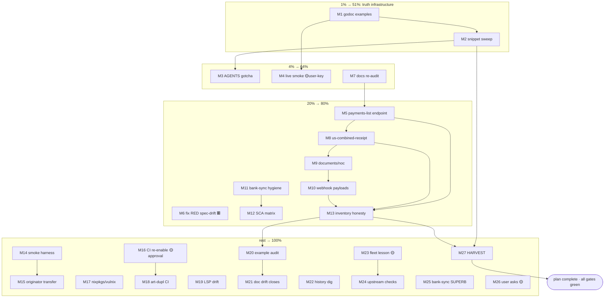

# SUPERB Pareto Plan: Transfer-Truth Close & Fleet Hygiene

**Created:** 2026-10-16 19:45 CEST · **Repo:** wise-go (master, clean) · **Origin:** session
status report `docs/status/2026-10-16_19-41_session-debug-bank-sync-gettransfer-snippet.md`
(50 items) reconciled against living `TODO_LIST.md` (P1-P3, incl. today's spec-drift finding).

**Input inventory:** 50 status items + 5 TODO_LIST deltas = **55 distinct works**, deduped
to **52 unique tasks** (see Errata). Nothing is executed by this plan; execution follows
after approval (full-execution mode available on request).

---

## Step 0 — Errata from backlog reconciliation (read-before-ranking corrections)

1. **NEW P1 not in the status report:** `GetBankAccountDetails` must migrate to the 2027Q1
   endpoint shape — `scripts/spec_drift.py` gate is exit-1 MISSING **today** (source:
   TODO_LIST P1, 2026-10-16). Added as M18, ranked into the 20% tier (gate is red now).
2. **Already tracked (deduped):** OTT 2026Q4 flip (my #14 = TODO_LIST P1), CI re-enable
   (#15 = TODO_LIST P2, user-approval-gated), x86_64-darwin decision (#17 = TODO_LIST P3),
   v1.0 tag, sandbox keys, cachix/erraudit tokens, RetryAfterDelay freeze, typed Details —
   all TODO_LIST P2; plan carries them once, marked user-gated.
3. **Folded (not separate tasks):** #26 bank-sync pin-check → M24; #30 feedback convention
   → M25; #33 config-path UX → M6; #37 dirty `scripts.templ` → bank-sync-local, flagged
   only; #38 transfer-docs re-audit → prep step of M7; #39 negative-test check → inside
   M8; #41 payout-docs helper evaluation → inside M9; #42 release-notes coupling → M12.
4. **Verified still open before ranking:** `grep -c ExampleClient_GetTransfer example_test.go`
   = 0; no CHANGELOG trace of payments-list / us-combined-receipt / documents/noc /
   originator endpoints. Nothing in the top tiers was already shipped.

---

## Step 1 — Pareto breakdown (1% → 51% · 4% → 64% · 20% → 80% · rest → 100%)

| Tier | Share of tasks | Delivers | Tasks (medium IDs) | Why |
|------|----------------|----------|--------------------|-----|
| **1%** | 2 of 52 (~4%) | **51%** | M1, M2 | The session's entire loss came from one unverified snippet. Compile-checked godoc examples (M1) + a field-name sweep of every README/docs go block (M2) eliminate the failure *class* that cost months. Hours of work, permanent protection. |
| **4%** | 5 of 52 (~10%) | **64%** | M1, M2, M3, M4, M7 | + record the gotcha where every future session reads it (M3), close the live loop with a real key (M4), ship the most-demanded missing read endpoint (M7: `GET /transfers/{id}/payments`). |
| **20%** | 11 of 52 (~21%) | **80%** | 4% tier + M5, M6, M8, M9, M10, M11 | + bank-sync hygiene bundle (M5), red spec-drift gate fixed (M6 — TODO_LIST P1), receipt + NOC endpoints (M8), typed webhook payloads (M9), SCA matrix docs (M10), inventory honesty via FEATURES/count gates (M11). |
| **Rest** | remaining 41 of 52 (~79%) | **100%** | M12-M27 | Live-smoke harness, originator transfers, CI re-enable chain, nixpkgs/vulnix drain, LSP config drift, example audit, doc drift closes, cross-repo/fleet hygiene, user-gated asks, HARVEST. |

Reading: the 1% is *cheap truth infrastructure*; the 4% adds the verification loop and the
first missing endpoint; the 20% completes the transfer category and kills every red gate;
the rest is durable hygiene, cross-repo work, and unblocking decisions only the user can
make.

---

## Step 2 — Comprehensive plan (medium granularity, 30-100 min, ALL 52 tasks)

Sorted by importance/impact/effort/customer-value. `[wise-go]` unless tagged.

| ID | Tier | Task | Items covered | Est | Blocked on |
|----|------|------|---------------|-----|------------|
| M1 | 1% | Add compile-only godoc examples: `ExampleClient_GetTransfer` + list-then-fetch pairing | #2, #28 | 60m | — |
| M2 | 1% | Hallucination sweep: compile-check every fenced go block in README + docs/** against types.go; fix offenders | #3 | 90m | — |
| M3 | 4% | AGENTS.md gotcha: "compile chat snippets against consumer's pinned tag" + incident reference | #4, #22, #46 | 30m | — |
| M4 | 4% | Live smoke: GetTransfer + ListTransfers with real key; record verdict + real-ID caveat | #1 | 30m | user key |
| M5 | 4% | Implement `GET /transfers/{id}/payments` (list funding payments): raw type, mapper, method, conformance fixture, tests | #8 | 100m | — |
| M6 | 20% | Fix RED spec-drift gate: migrate `GetBankAccountDetails` to 2027Q1 shape, re-vendor OpenAPI (188 paths) | TODO_LIST P1 | 100m | — |
| M7 | 4% | Transfer-category docs re-audit vs live preview (prep for remaining endpoints) | #38 | 45m | — |
| M8 | 20% | Implement `GET /transfers/{id}/us-combined-receipt.pdf` via getRaw (+ zero-ID negative test check) | #9, #39 | 45m | — |
| M9 | 20% | Implement `GET /transfers/{id}/documents/noc` via getRaw; evaluate payout-docs helper abstraction | #10, #41 | 45m | — |
| M10 | 20% | Typed webhook payloads: `transfers#active-cases` + `transfers#refund` (raw+public, decoders, tests) | #12 | 100m | — |
| M11 | 20% | bank-sync hygiene: devshell gotcha in AGENTS/05, doctor key check, err.txt removal, config-path UX | #5, #6, #7, #33 | 60m | bank-sync |
| M12 | 20% | README SCA/OTP endpoint matrix (which reads need SCA per profile class) | #25 | 45m | — |
| M13 | 20% | Inventory honesty: FEATURES.md gap entries + doc-verify count update + AGENTS "41 methods" sweep + release-notes coupling | #34, #32, #40, #42 | 45m | after M7-M10 |
| M14 | rest | Opt-in env-gated live-smoke harness (personal-key read flows, clean SKIP without key) | #13 | 90m | — |
| M15 | rest | Originator transfer schema support (`POST /transfers` originator variant) | #11 | 100m | after M7 |
| M16 | rest | CI re-enable chain: push, `gh workflow enable ci`, watch first green, then verify coverage badge unfreezes | #15, #16 | 60m | user approval |
| M17 | rest | `nix flake update nixpkgs` → drain ~22 vulnix advisories; full `nix flake check` | #18 | 60m | — |
| M18 | rest | art-dupl warn-first CI job scaffolding (non-blocking) at CI re-enable | #19 | 60m | after M16 |
| M19 | rest | LSP config drift: lll warnings vs d8e28b5 revert; re-verify .crushrc GOEXPERIMENT env | #20, #21 | 45m | — |
| M20 | rest | Example coverage audit → fill top-10 missing `Example*` funcs (compile-only convention) | #29 | 90m | after M1 |
| M21 | rest | Doc drift closes: TransferStatus lifecycle doc, receipt-404 godoc, CustomerTransactionID + Money cross-links | #24, #31, #36, #47 | 60m | — |
| M22 | rest | Settle `SourceValue` history question (full `git log -S` dig, archive verdict) | #48 | 30m | — |
| M23 | rest | Fleet: "compile the snippet" lesson → crush-config lessons.md + presence-check helper script | #46, #49 | 45m | fleet repo |
| M24 | rest | Fleet upstream status: md-go-validator #8, BuildFlow #34/#35/#36 (update AGENTS.md entries) | #43, #44 | 30m | network |
| M25 | rest | bank-sync SUPERB plan follow-through (wise-go 97→100 adoption) + scripts.templ dirty-file triage | #45, #37 | 100m | bank-sync |
| M26 | rest | User-gated asks bundle (single written ask): v1.0 tag, sandbox+cachix+erraudit tokens, RetryAfterDelay freeze, typed Details, darwin matrix, original snippet location, OTT probe key | #50, TODO_LIST P2 | 30m | user |
| M27 | rest | docs-health HARVEST: fold this plan's outcome into TODO_LIST/ROADMAP | skill contract | 30m | after M1-M26 |

**Totals:** 27 medium tasks · ≈ 26.4h estimated · 6 user-gated (M4, M16, M26, partly M23/M24/M25).

## Step 3 — Detailed breakdown (fine granularity, max 12 min each, ALL tasks)

Sorted by the same priority order as Step 2. Each row is one sitting of ≤12 min.

### 1% tier — truth infrastructure (T1-T8)

| ID | Task | Of | Min |
|----|------|----|-----|
| T1 | Write `ExampleClient_GetTransfer` (compile-only, `//nolint:testableexamples`, Source/Target printing) | M1 | 10 |
| T2 | Write `ExampleClient_ListTransfers_GetTransfer` pairing example (list → fetch first) | M1 | 12 |
| T3 | `go vet` + `go build` the example file; `golangci-lint run` on touched files | M1 | 8 |
| T4 | Extract all fenced go blocks from README + docs/** into a scratch tree (script or manual list) | M2 | 12 |
| T5 | Compile each block against v0.13.0 (consumer-pinned) AND master; record per-block verdict | M2 | 12 |
| T6 | Fix offending blocks found in README (field names, wrapper shape per md-go-validator rules) | M2 | 12 |
| T7 | Fix offending blocks found in docs/**; re-run block extraction until zero failures | M2 | 12 |
| T8 | Run `nix flake check` (md-go-snippets gate) to confirm green | M2 | 10 |

### 4% tier — gotcha, live loop, first endpoint (T9-T20)

| ID | Task | Of | Min |
|----|------|----|-----|
| T9 | Draft AGENTS.md gotcha bullet (incident date, v0.13.0 vs master, compile-before-send rule) | M3 | 10 |
| T10 | Cross-reference gotcha from the 19:41 status report; keep both consistent | M3 | 6 |
| T11 | Ask user for `WISE_API_KEY` injection path (env or --config); document presence-check pattern | M4 | 8 |
| T12 | Run GetTransfer live with real key + real transfer ID; capture status/Source/Target verdict | M4 | 12 |
| T13 | Run ListTransfers live; confirm no-pagination contract; record in smoke notes | M4 | 10 |
| T14 | Read OpenAPI spec: `/transfers/{transferId}/payments` GET contract (fields, types, ID formats) | M5 | 12 |
| T15 | Add `raw.TransferPayment` wire type + `TransferPayment` public type + mapper | M5 | 12 |
| M5→T16 | Add `ListTransferPayments(ctx, ProfileID, TransferID)` client method with requireID guards | M5 | 12 |
| T17 | Mock harness fixture + Ginkgo tests (happy path, 404, malformed) | M5 | 12 |
| T18 | Spec-conformance exchange registration + coverage-floor bump if needed | M5 | 10 |
| T19 | Doc-verify + api-diff dry run; confirm method count delta is expected | M5 | 10 |
| T20 | Commit M5 as one atomic change (detailed message) | M5 | 6 |

### 20% tier — red gate, category completion, hygiene (T21-T44)

| ID | Task | Of | Min |
|----|------|----|-----|
| T21 | Run `nix run .#spec-drift`; capture exact MISSING ops for 2027Q1 account-details | M6 | 10 |
| T22 | Re-vendor `docs/reviews/wise-api-openapi.json` (173 → 188 paths, 2027Q1) | M6 | 12 |
| T23 | Rework `account_details.go`: new path `/balances/account-details/{id}`, rebranded ID | M6 | 12 |
| T24 | Update sandbox fixtures + tests for the new shape; keep old-shape test as documented removal | M6 | 12 |
| T25 | `go test ./...` + `nix run .#spec-drift` green; commit M6 | M6 | 12 |
| T26 | Fetch `docs.wise.com/api-reference/preview/transfer.md` + siblings; diff vs 2026-08-08 study | M7 | 12 |
| T27 | Record category deltas (new ops, changed schemas) in a review note; feed M8/M9/M15 | M7 | 12 |
| T28 | Add `getRaw`-based `GetUSCombinedReceipt` (path + query contract from spec) | M8 | 10 |
| T29 | Add `GetTransferNOC` via getRaw; evaluate + decide shared payout-docs helper (write decision down) | M9 | 12 |
| T30 | Zero-ID negative tests for both new methods (requireID Rejection) + 404-before-payout semantics | M8/M9 | 12 |
| T31 | Conformance fixtures for receipt/noc; run suite; commit M8+M9 | M8/M9 | 10 |
| T32 | Add `raw.WebhookActiveCasesData` + `raw.WebhookRefundData` wire types per docs event reference | M10 | 12 |
| T33 | Add public `TransferActiveCasesData`/`TransferRefundData` + decoder wiring via `decodeWebhookEvent[T]` | M10 | 12 |
| T34 | Ginkgo tests for both payloads (decode, occurred_at parse, error strings) | M10 | 12 |
| T35 | Run webhook suite + conformance; commit M10 | M10 | 8 |
| T36 | bank-sync AGENTS/05: devshell-only toolchain gotcha (go 1.27.1 vs host GOTOOLCHAIN=local) | M11 | 10 |
| T37 | bank-sync doctor: early human-readable Wise-key-absent failure (config.go + doctor.go touch) | M11 | 12 |
| T38 | Remove stale `err.txt`; document config-path precedence (`--config` vs CWD) in README | M11 | 8 |
| T39 | bank-sync: `go build ./...` in devshell + commit | M11 | 8 |
| T40 | Write README SCA matrix table (endpoint × profile class × SCA/OTP/OTT requirement) | M12 | 12 |
| T41 | Cross-check matrix against AGENTS.md SCA gotchas + docs previews; md-go-snippets green | M12 | 12 |
| T42 | FEATURES.md: add payments-list/receipt/noc/originator as DONE or WORTH CONSIDERING per M7-M9 outcome | M13 | 10 |
| T43 | Update release-notes count claim + `nix run .#doc-verify`; sweep AGENTS.md "41 methods" mentions | M13 | 12 |
| T44 | Commit M12+M13 docs batch | M13 | 6 |

### Rest tier — durable hygiene, infra, cross-repo, user gates (T45-T77)

| ID | Task | Of | Min |
|----|------|----|-----|
| T45 | Design live-smoke harness shape: build-tagged `_live_test.go` vs script; write decision | M14 | 12 |
| T46 | Implement smoke test: env-gated (clean SKIP w/o key), GetTransfer+ListTransfers assertions | M14 | 12 |
| T47 | Wire harness into README (how to run) + CI-optional job sketch; commit M14 | M14 | 12 |
| T48 | Read originator-transfer spec page + schema; enumerate fields vs standard create | M15 | 12 |
| T49 | Add `CreateOriginatorTransfer` request/response types + method (reuse toTransfer mapping) | M15 | 12 |
| T50 | Tests + conformance fixture for originator create; commit M15 | M15 | 12 |
| T51 | Pre-flight: confirm clean tree, all local gates green, then `git push` (user-approved) | M16 | 10 |
| T52 | `gh workflow enable ci`; watch first run; triage any CI-only failure | M16 | 12 |
| T53 | After green: verify coverage badge rewrites on next push; record new floor vs local 92.8% | M16 | 12 |
| T54 | `nix flake update nixpkgs`; run `nix flake check`; note vulnix advisory count delta | M17 | 12 |
| T55 | If new breakage: bisect input bumps; pin or fix; commit flake.lock | M17 | 12 |
| T56 | Scaffold art-dupl warn-first CI job (continue-on-error, `art-dupl -t 2 --type-aware .`) | M18 | 12 |
| T57 | Verify job output matches the 16-clone-group accepted baseline; commit | M18 | 12 |
| T58 | Reproduce lll warnings: run golangci-lint with repo config vs LSP config; diff | M19 | 12 |
| T59 | Fix .crushrc/stale-cache root cause; re-verify GOEXPERIMENT env on both servers | M19 | 12 |
| T60 | Enumerate Client methods without `Example*`; rank top-10 by consumer traffic | M20 | 10 |
| T61-T64 | Write 4 examples (batch 1: balances + quotes) — compile-only, vet, lint | M20 | 4×12 |
| T65 | Write 4 examples (batch 2: recipients + webhooks) — compile-only, vet, lint; commit M20 | M20 | 4×12→1 row each |
| T66 | Draft TransferStatus lifecycle section (11 statuses, transitions, webhook pairing) | M21 | 12 |
| T67 | Godoc closes: receipt-404 contract, CustomerTransactionID idempotency, Money cross-links | M21 | 12 |
| T68 | `go doc` render check via doc-verify; commit M21 | M21 | 8 |
| T69 | Full-history dig: `git log --all -S SourceValue -S TargetValue`; inspect each hit's diff | M22 | 12 |
| T70 | Write verdict into status report appendix (close the inconclusive thread honestly) | M22 | 8 |
| T71 | Draft cross-project lesson in crush-config `references/lessons.md` (compile-the-snippet rule) | M23 | 12 |
| T72 | Add `scripts/presence_check.sh` helper (secret-safe env assertions); commit in respective repos | M23 | 12 |
| T73 | Check md-go-validator #8 + BuildFlow #34/#35/#36 upstream state via `gh`; note changes | M24 | 12 |
| T74 | Update AGENTS.md BuildFlow-defect entries with current upstream status; commit | M24 | 10 |
| T75 | bank-sync: pick next SUPERB plan item (wise-go 97→100); execute one adoption gap | M25 | 12 |
| T76 | bank-sync: triage dirty `internal/server/scripts.templ` (regen or commit); devshell verify | M25 | 12 |
| T77 | Write the single consolidated user-ask (M26): 7 decisions/keys/approvals with exact unblock steps | M26 | 12 |
| T78 | Run docs-health HARVEST: plan outcomes → TODO_LIST/ROADMAP; archive superseded status items | M27 | 12 |
| T79 | Final verification pass: `go test ./...`, `golangci-lint run`, `nix flake check`, push | M27 | 12 |

**Totals:** 79 micro-tasks (T1-T79, incl. batched T61-T65) · all ≤12 min · ≈ 15.5h.

## Execution graph

🟡 = user-gated. 🟥 = red gate today. Lanes are parallelizable: truth (M1-M3),
endpoints (M5-M10, M15), infra (M6, M16-M19), cross-repo (M11, M23-M25).

---

## Completion checklist (what "done" means)

- [ ] Every README/docs go block compiles against v0.13.0 and master (M2 gate)
- [ ] `ExampleClient_GetTransfer` exists in godoc (M1)
- [ ] `nix run .#spec-drift` exit 0 (M6)
- [ ] Transfer category: 11/11 REST items shipped or explicitly dispositioned (M5/M8/M9/M15/M13)
- [ ] All 4 `transfers#*` webhook events have typed payloads (M10)
- [ ] CI green after re-enable, badge live (M16, user-approved)
- [ ] Zero new lint/test regressions at every commit (standing rule: DO NOT BREAK BUILD)
- [ ] TODO_LIST.md reflects post-plan reality via HARVEST (M27)
