# SUPERB Pareto Plan: Health Honesty, Truth Gates & the Road to v1.0

**Created:** 2026-10-16 21:13 CEST · **Repo:** wise-go (master) · **Mode:** plan-only (execution on approval)
**Origin:** reconciliation of three sources —
(1) `docs/status/2026-10-16_20-41_samber-do-premise-review-and-health-findings.md` §f (24 items),
(2) living `TODO_LIST.md` (P1–P3 incl. this session's Health entries),
(3) the still-open subset of `docs/planning/2026-10-16_19-45_SUPERB-pareto-plan-transfer-truth-close-and-fleet-hygiene.md` (52 tasks).

**Inventory:** 24 + 15 + 52 raw items → deduped and freshness-checked to **40 unique open works**, organized into **27 medium tasks** (30–100 min) and **109 micro-tasks** (≤12 min). Nothing is executed by this file.

---

## Step 0 — Errata from backlog reconciliation (read-before-ranking corrections)

Freshness was verified against the code and sibling sessions before ranking, per the pareto-planning contract:

1. **19:45-plan M1 + M2 + M3 are DONE — dropped from this plan.** Evidence: `ExampleClient_GetTransfer` exists (3 hits in `example_test.go`), and the AGENTS.md gotcha records "Full sweep 2026-10-16 (Pareto plan M2): all 33 README/docs go blocks verified". The snippet-truth infrastructure tier of the 19:45 plan shipped.
2. **19:45-plan M5 (payments-list endpoint) is still OPEN.** `transfers.go` builds `.../payments` only inside `FundTransfer` (POST); there is no funding-payments *list* method, and the surface count is still 41 — consistent.
3. **19:45-plan M6 = TODO_LIST P1 = this plan's M1.** The spec-drift gate (`nix run .#spec-drift`) is still exit-1 MISSING (live 2027Q1 spec moved `account-details`). Carried once, ranked #1.
4. **20:41-report f9/f10 RESOLVED by evidence** — the 21:09 cross-repo status report claims the SCA-typing commits (`ec12a70`/`113d9f0` daemon-carried; `e1912ee`/`e066132`/`1f4b99d` detailed). Downgraded from "inspect" to a 12-min spot-check folded into M21.
5. **20:41-report f1/f8 were already harvested** into `TODO_LIST.md` P3 this session — deduped, ranked here at their TODO priority.
6. **Parallel-session safety:** `wise_test.go` is modified in-flight and `docs/status/2026-10-16_21-09_*.md` is uncommitted — both belong to the active SCA-typing session. This plan does NOT touch them; any task that edits `wise_test.go` (M4) must re-read the file immediately before editing and rebase on whatever the parallel session landed.
7. **Out of scope (other repos, carried once):** bank-sync hygiene (19:45-plan M11/M25) and fleet-repo work stay tagged `[bank-sync]`/`[fleet]` and are bundled in M23 only as pointers.

---

## Step 1 — Pareto breakdown (1% → 51% · 4% → 64% · 20% → 80% · rest → 100%)

The "result" = a release-ready SDK: every truth gate green, the one dishonest API surface fixed, the most-demanded missing endpoints shipped, and the v1.0 decision unblocked.

| Tier | Share of tasks | Delivers | Tasks (medium IDs) | Why |
|------|----------------|----------|--------------------|-----|
| **1%** | 2 of 27 (~7%) | **51%** | M1, M2 | M1 kills the ONLY red gate (spec-drift exit-1) by migrating `GetBankAccountDetails` to the 2027Q1 shape and re-vendoring the spec. M2 then re-measures and records the full gate battery — converting "assumed green" into "proven green at a timestamp". Everything downstream (v1.0, releases, endpoint work) is gated on these two. Hours of work, whole-chain unblock. |
| **4%** | 5 of 27 (~19%) | **64%** | M1–M5 | + the Health honesty bundle: F-1 is the only finding from today's architecture review — the SDK's one dishonest surface (`Health` documented as "reachability", behaving as a retried credential probe). M3 fixes the words, M4 pins the typed-error contract in tests, M5 ships the consumer-side DI/health recipe (the review's composability payoff, and direct customer value for orchestrator users). |
| **20%** | 12 of 27 (~44%) | **80%** | M1–M12 | + truth infrastructure that prevents recurrence (M6 anchor sweep, M7 anchor-checker wired into doc-verify — the drift class found today: 8 dead anchors, doc-verify gates counts, not line refs) and the transfer-truth close: payments-list (M8), us-combined-receipt (M9), NOC (M10), live-docs re-audit (M11), and the inventory-honesty sweep so counts/gates/AGENTS all say the same number (M12). |
| **Rest** | 15 of 27 (~56%) | **100%** | M13–M27 | Typed webhook payloads, SCA matrix docs, live-smoke harness, originator transfers, examples audit, doc-drift closes, nixpkgs/vulnix drain, art-dupl CI scaffold, LSP/commit hygiene, SourceValue history, fleet pointers, the single user-decisions ask, the key-gated track, and the mandatory HARVEST. |

Reading: the 1% is the one red gate + proof of green; the 4% makes the API story honest and composability tangible; the 20% prevents every drift class found today from recurring and finishes the transfer category; the rest is durable hygiene, cross-repo pointers, and the decisions only the user can make.

---

## Step 2 — Comprehensive plan (medium granularity, 30–100 min each, ALL tasks)

Sorted by importance/impact/effort/customer-value. `[user]` = needs user input/key; `[bank-sync]`/`[fleet]` = other repos.

| ID | Tier | Task | Est | Depends on |
|----|------|------|-----|------------|
| M1 | 1% | Migrate `GetBankAccountDetails` to 2027Q1 (`GET /balances/account-details/{id}`, new ID space), re-vendor `wise-api-openapi.json`, spec-drift green, conformance fixtures | 100m | — |
| M2 | 1% | Gate battery re-certification: doc-verify, `nix flake check`, spec-drift, `go test -race`, fresh conformance figures recorded (replaces the memory-cited "202/202") | 60m | M1 |
| M3 | 4% | F-1 docs-half: rewrite `Health` doc comment (`client.go:183`) + README + FEATURES row to honest readiness-probe semantics (typed-error guidance, worst-case latency) | 45m | — |
| M4 | 4% | Pin `Health` typed-error contract in `Describe("Health")`: 429 → `*RateLimitError`, bad key → `*AuthError`; re-read file first (parallel session) | 60m | M3 |
| M5 | 4% | README consumer-side DI + health-check recipe (adapter + `do.Provide`), compile-checked vs v0.13.0; pointer to the `HealthCheck`-alias decision | 45m | M3 |
| M6 | 20% | Repo-wide anchor sweep: every `*.go:NN` ref in README/FEATURES/TODO/ROADMAP/docs verified against declarations; fix all drifts (incl. `wise_test.go:246` after parallel session lands) | 90m | — |
| M7 | 20% | `anchor-check` script (extract `file.go:NN` refs → assert line contains symbol), wire into doc-verify + `nix flake check`, AGENTS.md gotcha | 100m | M6 |
| M8 | 20% | Implement `GET /v1/profiles/{id}/transfers/{id}/payments` (funding-payments list): raw type, mapper, method, conformance fixture, BDD tests | 100m | — |
| M9 | 20% | Implement `GET /transfers/{id}/us-combined-receipt.pdf` via `getRaw` + zero-ID guard + fixture/tests | 45m | — |
| M10 | 20% | Implement `GET /transfers/{id}/documents/noc` via `getRaw` + fixture/tests | 45m | — |
| M11 | 20% | Transfer-category re-audit vs live preview (`.md` fetch); refresh the FEATURES coverage matrix deltas | 45m | — |
| M12 | 20% | Inventory honesty after M8–M10: FEATURES counts, doc-verify gate numbers, AGENTS "41 methods" sweep, release-notes coupling | 45m | M8, M9, M10 |
| M13 | rest | Typed webhook payloads for `transfers#active-cases` + `transfers#refund` (raw+public via `decodeWebhookEvent[T]`, accessors, vector tests) | 100m | — |
| M14 | rest | README SCA/OTP matrix: which reads need SCA per profile class, ~90-day cycle, 5-minute clearance session | 45m | — |
| M15 | rest | Opt-in env-gated live-smoke harness (read flows, clean SKIP without key) | 90m | — |
| M16 | rest | Originator transfer schema (`POST /transfers` originator variant) | 100m | M11 |
| M17 | rest | Example coverage audit → fill top-10 missing `Example*` funcs (compile-only convention) | 90m | — |
| M18 | rest | Doc-drift closes bundle: TransferStatus lifecycle doc, receipt-404 godoc, Money/`CustomerTransactionID` cross-links, stateless-client invariant note | 60m | — |
| M19 | rest | `nix flake update nixpkgs` → drain ~22 vulnix advisories; full `nix flake check` | 60m | — |
| M20 | rest | art-dupl warn-first (non-blocking) CI job scaffold, ready for CI re-enable | 60m | M25 (CI approval) |
| M21 | rest | Hygiene spot-checks: `.crushrc` GOEXPERIMENT env still applied (gopls A/B), `lll` still absent from linter list, spot-check daemon commit `113d9f0` content | 45m | — |
| M22 | rest | `SourceValue` history dig (`git log -S`), archive the verdict | 30m | — |
| M23 | rest | Fleet pointers: compile-snippet lesson → crush-config `lessons.md`; upstream status refresh (md-go-validator #8, BuildFlow #34/#35/#36) | 45m | network |
| M24 | rest | Series + convention closes: read 2026-07-18 HTML scorecards fully, reconcile open items into the 19:59 review; record .md/HTML output-convention decision; ANNOTATE the 19:59 review for F-2 | 45m | — |
| M25 | rest | The ONE written user-ask bundle: v1.0 tag approval, Health code-half semantics, `HealthCheck` alias, `RetryAfterDelay` freeze, typed `Details`, darwin matrix, format convention, cachix/erraudit/sandbox keys, CI enable, OTT probe key | 30m | user |
| M26 | rest | Key-gated track (procedures ready, execution on key arrival): sandbox live pass, credentialed integration tests, OTT 2026Q4 flip | 60m | user key |
| M27 | rest | docs-health HARVEST: route this plan's outcomes into `TODO_LIST.md`/`ROADMAP.md`; annotate/archive superseded items | 30m | after M1–M26 |

**Totals:** 27 medium tasks · ≈ 26.3 h · 3 unblocked 1%-tier tasks · 4 user/key-gated (M20, M25, M26; M4/M6 partially race-gated on the parallel session).

## Step 3 — Detailed breakdown (fine granularity, ≤12 min each, ALL tasks)

Sorted by the same priority order. Each row is one sitting.

### 1% tier — the red gate and proof of green (T1–T13)

| ID | Task | Of | Min |
|----|------|----|-----|
| T1 | Fetch live preview `account-details` page; capture request/response contract + new ID semantics | M1 | 12 |
| T2 | Migrate `account_details.go`: new path `GET /balances/account-details/{id}`, new branded ID type | M1 | 12 |
| T3 | Update mapper + sandbox fixtures for the new shape | M1 | 12 |
| T4 | Fetch live 2027Q1 OpenAPI (custom User-Agent); re-vendor `docs/reviews/wise-api-openapi.json` | M1 | 12 |
| T5 | Adjust `scripts/spec_drift.py` extraction if needed; run `nix run .#spec-drift` → exit 0 | M1 | 12 |
| T6 | Conformance fixtures for the new endpoint; floors still hold (`zz_` guard) | M1 | 12 |
| T7 | CHANGELOG entry + AGENTS.md gotcha update (spec-drift resolved, new vendored vintage) | M1 | 8 |
| T8 | `nix run .#apidiff` sanity (no unintended API movement) | M1 | 8 |
| T9 | `nix run .#doc-verify` → record result | M2 | 10 |
| T10 | `nix flake check` → record result | M2 | 10 |
| T11 | `go test -race ./...` → record result | M2 | 12 |
| T12 | Fresh conformance counts (templates/exchanges/variants); replace the "202/202 at v0.12.0" memory figure in the 19:59 review §8 with the measured one (annotate, not rewrite) | M2 | 12 |
| T13 | `nix run .#release-notes-check` + pin-sync quick pass → record | M2 | 8 |

### 4% tier — Health honesty + composability payoff (T14–T27)

| ID | Task | Of | Min |
|----|------|----|-----|
| T14 | Rewrite `Health` doc comment (`client.go:183`): credential-validating readiness probe, typed-error guidance, ~2-min worst case | M3 | 10 |
| T15 | Rewrite README Health block to the same semantics | M3 | 10 |
| T16 | Sync FEATURES.md Health row wording | M3 | 8 |
| T17 | `nix fmt` + md-go-snippets gate after README edit | M3 | 8 |
| T18 | CHANGELOG fold for M3 (with dprint-covered co-change) | M3 | 6 |
| T19 | Re-read `wise_test.go` `Describe("Health")` (parallel session may have moved it); note current asserts | M4 | 8 |
| T20 | Add 429 case: `Health` surfaces `*RateLimitError` (proves reachability-with-throttling) | M4 | 12 |
| T21 | Add bad-key case: `Health` surfaces `*AuthError` | M4 | 12 |
| T22 | Add retry-exhaustion case: typed `*ServerError` reached through `ErrExhausted` | M4 | 12 |
| T23 | Run suite + `-race`; revert nothing from the parallel session; commit only own lines if separable, else defer | M4 | 10 |
| T24 | Draft README recipe: composition root + `do.Provide` + `healthAdapter` (review §5 snippet) | M5 | 12 |
| T25 | Compile-check the snippet against v0.13.0 (consumer-pinned) AND master in a scratch module | M5 | 12 |
| T26 | Insert README section; run links check | M5 | 12 |
| T27 | Add pointer to the `HealthCheck`-alias decision (M25) in the recipe footnote | M5 | 6 |

### 20% tier — drift prevention + transfer-truth close (T28–T63)

| ID | Task | Of | Min |
|----|------|----|-----|
| T28 | Extract all `*.go:NN` refs from README into a list | M6 | 12 |
| T29 | Same for FEATURES.md | M6 | 12 |
| T30 | Same for TODO_LIST/ROADMAP + docs/** (excluding archived/, reviews HTML) | M6 | 12 |
| T31 | Script the verification pass (line contains claimed symbol); produce drift report | M6 | 12 |
| T32 | Fix drifts batch 1 (README) | M6 | 12 |
| T33 | Fix drifts batch 2 (FEATURES + TODO/ROADMAP) | M6 | 12 |
| T34 | Fix drifts batch 3 (docs/**) + record `wise_test.go:246` verdict once parallel session lands | M6 | 12 |
| T35 | Write `scripts/anchor_check.py` (extract + assert, exit non-zero on drift) | M7 | 12 |
| T36 | Negative-test the script (craft a bad ref, expect failure) | M7 | 12 |
| T37 | Wire `nix run .#anchor-check` + sandboxed check; update flake filesets | M7 | 12 |
| T38 | AGENTS.md gotcha: "line-anchor refs rot silently; doc-verify gates counts only; anchor-check guards it" | M7 | 10 |
| T39 | `nix flake check` green with the new check | M7 | 10 |
| T40 | CHANGELOG fold for M6+M7 | M7 | 6 |
| T41 | Capture payments-list contract from spec/preview (path, query, response envelope) | M8 | 12 |
| T42 | Raw type `raw.TransferFundingPayment` with exact JSON tags | M8 | 12 |
| T43 | Mapper to public type (Money conversion, status enum) | M8 | 12 |
| T44 | Client method + `requireID` guards + validation | M8 | 12 |
| T45 | Conformance fixture + recorded exchange | M8 | 12 |
| T46 | BDD tests (happy path + error paths) | M8 | 12 |
| T47 | Lint + race + surface-count bump (41 → 42) in local run | M8 | 10 |
| T48 | Capture us-combined-receipt contract (content-type, 404 semantics) | M9 | 8 |
| T49 | Method via `getRaw` + zero-ID guard + godoc (404-not-yet-paid-out semantics) | M9 | 12 |
| T50 | Conformance fixture (statement-file-format exemption pattern if needed) | M9 | 12 |
| T51 | BDD tests incl. 404 → `*NotFoundError` semantics | M9 | 12 |
| T52 | Gates: lint + race | M9 | 8 |
| T53 | Capture NOC contract | M10 | 8 |
| T54 | Method via `getRaw` + guard | M10 | 12 |
| T55 | Fixture + BDD tests | M10 | 12 |
| T56 | Gates: lint + race | M10 | 8 |
| T57 | Fetch transfer category `.md` from live preview | M11 | 12 |
| T58 | Diff live ops vs FEATURES coverage matrix | M11 | 12 |
| T59 | Write gap deltas into FEATURES (tier labels per plan taxonomy) | M11 | 12 |
| T60 | FEATURES counts update after M8–M10 | M12 | 12 |
| T61 | doc-verify gate numbers update (count claims) | M12 | 12 |
| T62 | AGENTS.md "41 methods" sweep → new count everywhere | M12 | 10 |
| T63 | Release-notes coupling check (latest notes method count) | M12 | 12 |

### Rest tier — durable hygiene, features, decisions (T64–T109)

| ID | Task | Of | Min |
|----|------|----|-----|
| T64 | Capture payload shapes for `transfers#active-cases` + `transfers#refund` from webhook reference | M13 | 12 |
| T65 | Raw payload structs (snake_case tags, path-excluded from tagliatelle) | M13 | 12 |
| T66 | Public structs + decoders via `decodeWebhookEvent[T]` | M13 | 12 |
| T67 | Accessors + unit tests | M13 | 12 |
| T68 | Extend webhook-vector test with both events | M13 | 12 |
| T69 | Golden payloads + gates (lint, race) | M13 | 12 |
| T70 | Compile per-profile-class SCA matrix from the sca-otp docs research | M14 | 12 |
| T71 | README SCA matrix section | M14 | 12 |
| T72 | Links/format gates | M14 | 8 |
| T73 | Scaffold env-gated live-smoke file | M15 | 12 |
| T74 | Read-flow smoke cases (profiles, balances, rates) | M15 | 12 |
| T75 | Verify clean SKIP without key (suite stays green) | M15 | 12 |
| T76 | Workflow dispatch wiring (sandbox-live pattern) | M15 | 12 |
| T77 | Capture originator schema from spec/preview | M16 | 12 |
| T78 | Request struct variant + wire fields | M16 | 12 |
| T79 | Validation + `detailsWire()` delegation | M16 | 12 |
| T80 | Fixture + BDD tests | M16 | 12 |
| T81 | List exported methods vs existing `Example*` funcs | M17 | 10 |
| T82 | Write top-5 missing examples (compile-only convention) | M17 | 12 |
| T83 | Write next-5 missing examples | M17 | 12 |
| T84 | `go vet` + lint on example file | M17 | 8 |
| T85 | TransferStatus lifecycle doc (states + transitions) | M18 | 12 |
| T86 | Receipt-404 godoc on `GetTransferReceipt` ("no receipt yet" semantics) | M18 | 8 |
| T87 | Money / `CustomerTransactionID` cross-links in godoc | M18 | 10 |
| T88 | Stateless-client invariant note (AGENTS + README: why no Shutdown exists) | M18 | 12 |
| T89 | `nix flake update nixpkgs` | M19 | 12 |
| T90 | Build + full `nix flake check` after update | M19 | 12 |
| T91 | vulnix recount + record the delta | M19 | 12 |
| T92 | art-dupl warn-first job YAML (non-blocking, SARIF optional) | M20 | 12 |
| T93 | Verify non-blocking behavior locally (findings present → job still green) | M20 | 10 |
| T94 | `.crushrc` GOEXPERIMENT verify + gopls A/B check | M21 | 12 |
| T95 | Confirm `lll` absent from `.golangci.yml` curated list | M21 | 8 |
| T96 | Spot-check daemon commit `113d9f0` diff vs the 21:09 report's claims | M21 | 12 |
| T97 | `git log -S SourceValue` dig; write verdict into the archived review thread | M22 | 12 |
| T98 | crush-config `lessons.md`: compile-snippets-against-pinned-tags lesson | M23 | 12 |
| T99 | Upstream issue status refresh (md-go-validator #8, BuildFlow #34/#35/#36) + AGENTS updates | M23 | 12 |
| T100 | Read 2026-07-18 HTML scorecards/roadmaps fully | M24 | 12 |
| T101 | Reconcile still-open items into the 19:59 review (annotate) | M24 | 12 |
| T102 | Record the .md/HTML output-convention decision (from M25 answer) in the skill/notes | M24 | 6 |
| T103 | ANNOTATE 19:59 review: F-2 resolved at `862dbbf` | M24 | 6 |
| T104 | Draft the single written user-ask (all M25 decisions + tokens in one message) | M25 | 12 |
| T105 | Sandbox live-pass procedure checklist (5 spec-vs-live assumptions) | M26 | 12 |
| T106 | Credentialed integration-test key-drop checklist | M26 | 12 |
| T107 | OTT 2026Q4 probe procedure re-verify (sandbox key needed) | M26 | 12 |
| T108 | HARVEST: route M1–M26 outcomes into TODO_LIST/ROADMAP with routing rigor | M27 | 12 |
| T109 | Annotate/archive superseded TODO items + this plan's resolved rows | M27 | 12 |

---

## Execution graph (mermaid)

```mermaid
flowchart TD
    subgraph T1["1% → 51%: truth gate"]
        M1["M1 account-details 2027Q1 migration"]
        M2["M2 gate battery re-certification"]
    end
    subgraph T4["4% → 64%: health honesty"]
        M3["M3 Health docs-half"]
        M4["M4 Health typed-error tests"]
        M5["M5 README DI + health recipe"]
    end
    subgraph T20["20% → 80%: drift prevention + transfer truth"]
        M6["M6 anchor sweep"]
        M7["M7 anchor-check tooling"]
        M8["M8 payments-list endpoint"]
        M9["M9 us-combined-receipt"]
        M10["M10 documents/noc"]
        M11["M11 transfer docs re-audit"]
        M12["M12 inventory honesty"]
    end
    subgraph TR["rest → 100%"]
        M13["M13 typed webhooks"]
        M14["M14 SCA matrix"]
        M15["M15 live-smoke harness"]
        M16["M16 originator transfers"]
        M17["M17 examples audit"]
        M18["M18 doc-drift closes"]
        M19["M19 nixpkgs/vulnix drain"]
        M20["M20 art-dupl CI job"]
        M21["M21 hygiene spot-checks"]
        M22["M22 SourceValue dig"]
        M23["M23 fleet pointers"]
        M24["M24 series closes"]
        M25["M25 user-asks bundle"]
        M26["M26 key-gated track"]
        M27["M27 HARVEST"]
    end
    USER(["user decisions / keys"])
    M1 --> M2
    M3 --> M4
    M3 --> M5
    M6 --> M7
    M8 --> M12
    M9 --> M12
    M10 --> M12
    M11 --> M16
    M25 --> M20
    M25 --> M24
    USER --> M25
    USER --> M26
    M25 -.-> M4
    M2 --> M27
    M4 --> M27
    M5 --> M27
    M7 --> M27
    M12 --> M27
    M13 --> M27
    M14 --> M27
    M15 --> M27
    M16 --> M27
    M17 --> M27
    M18 --> M27
    M19 --> M27
    M20 --> M27
    M21 --> M27
    M22 --> M27
    M23 --> M27
    M24 --> M27
    M26 --> M27
```

Parallel lanes: M6/M7 (tooling) is independent of M8–M10 (endpoints); M13–M19 can run in any order after the 4% tier; everything funnels into M27 (HARVEST).

---

## Verschlimmbessern guards (rule 5 — read before executing ANY task)

1. **Do not touch the parallel session's in-flight files** (`wise_test.go`, `docs/status/2026-10-16_21-09_*.md`) — re-read immediately before any edit that must land there (T19–T23).
2. **`go 1.26` directive is settled** — never "fix" it to 1.26.7 or 1.27; buildflow normalize owns the form; the Go 1.27 migration is a separate gated plan.
3. **Do not lift the buildflow `erraudit` skip_steps** — the embedded analyzer's 29 findings are upstream false positives (BuildFlow #34); the standalone gate governs.
4. **Do not add nil checks in `webhooks.go`** dereference sites; the two `//nolint:branching-flow:panic` suppressions are verified-correct placements.
5. **Do not merge the raw/public `TransferRequirement` mirror pair** via aliases (wire-tag leak).
6. **Do not re-add `lll`** to the linter list — it was deliberately removed twice (most recently by the 21:09 session).
7. **Changelog-only commits structurally fail pre-commit** — always fold CHANGELOG edits with a dprint-covered file.
8. **Never pipe an exit-code gate** — `cmd | tail; echo $?` masks failures; capture exit before piping.
9. **Health semantics changes are user-gated** (M25) — execute only the docs-half (M3) without approval; no fail-fast path or alias before the decision.
10. **Do not convert existing `.md` reports/plans to HTML** retroactively; the format-convention decision (M25/M24) governs future artifacts only.
11. **After any `go get` or buildflow run: `grep '^go ' go.mod`** before committing.
12. **Snippet rule stands:** every README/docs go snippet must compile against the consumer's pinned tag (v0.13.0) AND master (T25 codifies it for the new recipe).

---

## HARVEST + execution notes

- **This plan surfaced no brand-new works** beyond the 20:41 f-list already partially harvested; the M6/M7/M18/M24 items and several rest-tier items are NEW to `TODO_LIST.md` and are routed by **M27 (HARVEST)** — deliberately NOT pre-harvested so TODO_LIST receives the post-execution truth, not the pre-execution guess (matches the 19:45 plan's M27 pattern).
- **Execution model:** plan-only now. On approval, run tiers in order: 1% → 4% → 20% → rest, honoring the dependency edges and the guards above; gates after every code touch (`go test -race`, `golangci-lint run`, `nix flake check`).
- **Completion bar:** spec-drift exit 0, doc-verify green with anchor-check wired, Health story honest + test-pinned, transfer category closed, counts consistent everywhere, HARVEST done.

_Point-in-time plan, 2026-10-16 21:13 CEST. Annotate inline (docs-health ANNOTATE) as tasks complete; archive when fully superseded._
