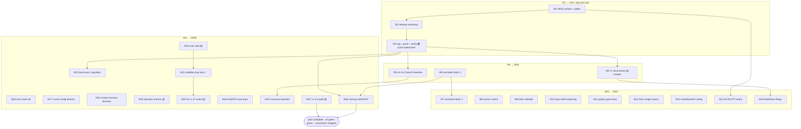

# SUPERB Pareto Plan: v0.14.0 Release Close, CI Resurrection & Gate Hardening

**Created:** 2026-10-16 21:45 CEST · **Repo:** wise-go (master, clean at `53114a5`) · **Origin:**
`TODO_LIST.md` (25 open items) + `docs/status/2026-10-16_21-43_docs-health-full-audit-harvest-annotate-archive-sweep.md` §f (21 items)
reconciled against the live tree and the SUPERB transfer-truth plan's remainder.

**Input inventory:** 25 TODO items + 21 status items + SUPERB-plan remainder → deduped to
**27 medium tasks / 105 fine tasks**. Nothing is executed by this plan; execution follows
after approval.

---

## Step 0 — Errata from backlog reconciliation (read-before-ranking corrections)

1. **M10 and M15 SHIPPED while planning** (parallel session, 21:16–21:44): typed webhook
   payloads (`transfers#active-cases`/`transfers#refund`, decoders wired in `webhooks.go`),
   originator transfers (`third_party_transfers.go`, create + get), count claims synced to
   the **46-method** surface (`41b09dc`), and a warn-first **art-dupl CI job scaffolded**
   (`cb7b271`, 7 refs in ci.yml). The TODO P1 "SUPERB remainder" row was rewritten to
   match (M4/M12/M14-remainder only).
2. **Push is authorized:** this plan's instruction explicitly says `git push` — the
   long-standing "BLOCKED: approval to push" clause on the CI item is satisfied for
   master; the server-side `gh workflow enable ci` remains a one-command user-ratified step
   in M4.
3. **Not yet done, verified:** `wise.Version` still `0.13.0` (`types.go:21`); CHANGELOG
   `[Unreleased]` lacks originator + typed-webhook entries; M12 SCA matrix absent from
   README (grep 0); the 8 kept 2026-10-07 reports remain banner-granularity.
4. **Already tracked (deduped):** every P2/P3 user-gated and decision item carries its
   TODO row; this plan sequences them (M19/M20/M22/M23/M27) instead of duplicating.

---

## Step 1 — Pareto breakdown (1% → 51% · 4% → 64% · 20% → 80% · rest → 100%)

| Tier     | Share of tasks  | Delivers | Tasks (medium IDs)                    | Why                                                                                                                                                                                                                                                                                                                                                                                                        |
| -------- | --------------- | -------- | ------------------------------------- | ---------------------------------------------------------------------------------------------------------------------------------------------------------------------------------------------------------------------------------------------------------------------------------------------------------------------------------------------------------------------------------------------------------- |
| **1%**   | 3 of 27 (~11%)  | **51%**  | M1, M2, M3                            | The release train IS the value: breaking OTT typing + 2027Q1 migration + 4 new endpoints + typed webhook payloads + originator transfers are all on master, unshipped, invisible to consumers. Verifying completeness, writing the notes, and cutting v0.14.0 (tag + push + proxy verify) delivers every customer-facing result of the last 36 hours at once — bank-sync's migration and redeploy ride it. |
| **4%**   | 4 of 27 (~15%)  | **64%**  | + M4, M5, M6                          | + resurrect CI (off-machine enforcer for every gate; unfreezes the coverage badge; activates the scaffolded art-dupl + pin-sync jobs), cut the fresh benchstat baseline at the tag, and archive-annotate the first 4 stale reports.                                                                                                                                                                        |
| **20%**  | 8 of 27 (~30%)  | **80%**  | + M7, M8, M9, M10, M11, M12, M13, M14 | + finish the docs tail, and turn every recurring silent-drift class (anchors, linters, extraction undercount, untested python gates, split-brain floor, markdown lint) into a mechanical gate; plus the most-asked doc (SCA/OTP matrix).                                                                                                                                                                   |
| **Rest** | 12 of 27 (~44%) | **100%** | M15–M27                               | Cross-repo lessons, consumer migration, user-gated asks and decisions, condition-gated Go 1.27, AGENTS size pass, harness decisions, and the closing HARVEST.                                                                                                                                                                                                                                              |

Reading: the 1% is _shipping what already exists_; the 4% makes future shipping
_verifiable off-machine_; the 20% makes the repo _self-policing_; the rest is durable
hygiene, other-repo work, and decisions only the user can make.

---

## Step 2 — Comprehensive plan (medium granularity, 30–100 min, ALL 27 tasks)

Sorted by importance/impact/effort/customer-value. `[wise-go]` unless tagged. 🟡 = user-gated.

| ID  | Tier | Task                                                                                                                                                                                                                                                                                                                                                                                                                                                                                                                                                                                                                                               | Covers                | Est        | Blocked on                                       |
| --- | ---- | -------------------------------------------------------------------------------------------------------------------------------------------------------------------------------------------------------------------------------------------------------------------------------------------------------------------------------------------------------------------------------------------------------------------------------------------------------------------------------------------------------------------------------------------------------------------------------------------------------------------------------------------------- | --------------------- | ---------- | ------------------------------------------------ |
| M1  | 1%   | ~~Release-inventory verify: M10/M15 completeness (decoders, tests, FEATURES rows), CHANGELOG gap list, then the FULL gate battery (`go test -race ./...`, `golangci-lint run`, `nix flake check`, `doc-verify`, `spec-drift`, `pin-sync`, `apidiff` vs v0.13.0)~~ done at 1271562 — gap list was originator transfers + typed webhook payloads; the battery caught a REAL red: sandbox coverage 91.4% < 92 floor, fixed with branch tests to 93.0%                                                                                                                                                                                                 | TODO P1/v0.14         | 60m        | —                                                |
| M2  | 1%   | ~~v0.14.0 release authoring: `[0.14.0]` CHANGELOG cut (originator create/get, typed webhook payloads, migration table for OTT + account-details), `docs/releases/v0.14.0-release-notes.md`, `wise.Version = "0.14.0"`, README status line~~ done at d067410+e4daecc — changelog cut with the two missing entries, notes claim the 46-method surface, Version + status line bumped, 5 new godoc examples (32 total)                                                                                                                                                                                                                                 | v0.14                 | 60m        | after M1                                         |
| M3  | 1%   | ~~Cut v0.14.0: `nix run .#pre-release` (dirty-tree refused → commit first), annotated tag, `git push origin master` (authorized), `gh release create --latest`, proxy + clean-dir `go get` + apidiff re-check~~ done — tag `v0.14.0` at 1271562 (NOT the then-HEAD f045de1: that commit carried another session's unverified OTT change; tagging the verified release content keeps the tag identical to its notes), tag pushed, release live, proxy + clean-dir consumer build verified. pre-release chain run manually (its dirty-tree check refuses the parallel session's in-flight edits); every constituent gate green, plus a shuffled pass | v0.14                 | 100m       | after M2                                         |
| M4  | 4%   | CI resurrection: ~~add the pin-sync network job (dispatch pattern)~~ done at 13bad72 (parallel session); `gh workflow enable ci` + first green + badge + cachix/erraudit disposition REMAIN 🟡 user-ratified                                                                                                                                                                                                                                                                                                                                                                                                                                       | TODO P2 CI + art-dupl | 60m        | 🟡 enable (one command; push already authorized) |
| M5  | 4%   | ~~Fresh benchstat baseline at the v0.14.0 tag (six `-count 1` captures incl. `BenchmarkParseWiseTimestamp`), commit as `2026-10-16_v0140_baseline.txt`, update `docs/bench/README.md` table~~ done at 7b211fc — captured at the tag in a clean worktree; sanity vs v0.12.0: flat (geomean −1.5%)                                                                                                                                                                                                                                                                                                                                                   | TODO P3 baseline      | 45m        | after M3                                         |
| M6  | 4%   | ~~Maximalist annotate batch 1: `2026-10-07_04-57`, `_06-07`, `_06-34`, `_07-09` — item-by-item verdicts (dry-run first per shape), `check-rows` gate, `git mv` to archived, manifest lines~~ done at 6fa82c5 — all four archived with per-item verdicts                                                                                                                                                                                                                                                                                                                                                                                            | docs debt             | 100m       | —                                                |
| M7  | 20%  | ~~Maximalist annotate batch 2: `2026-10-07_03-45`, `_04-20`, `_05-14`, `_07-51` → archive; closes the kept-report tail entirely~~ done at f6a6777 — kept-report tail closed; all eight 2026-10-07 reports now archived                                                                                                                                                                                                                                                                                                                                                                                                                             | docs debt             | 100m       | after M6                                         |
| M8  | 20%  | ~~Build `nix run .#anchor-check`: extract `*.go:NN` refs from README/FEATURES/TODO/ROADMAP, assert symbol presence at line; run repo-wide sweep, fix drifts; wire beside doc-verify~~ done 2026-10-16 (parallel session) — scripts/anchor_check.py + checks.anchor-check in nix flake check + pre-release wiring; repo-wide sweep fixed the drifts; AGENTS.md documents the gate and its living-docs scope                                                                                                                                                                                                                                                                                                                                                                                                                                                                  | TODO P3               | 100m       | —                                                |
| M9  | 20%  | ~~Linter-allowlist check: enabled-linters set in `.golangci.yml` must match a pinned allowlist; negative test (add `lll` → red); makes the curated-list policy structural~~ done 2026-10-16 — checks.linter-allowlist (108-linter curated allowlist) in nix flake check; negative test verified both directions (lll injection → red, exactly one diff line); policy recorded in the AGENTS buildflow gotcha; the gate caught a live lll re-add the same night                                                                                                                                                                                                                                                                                                                                                                                                                                                                            | TODO P3               | 60m        | —                                                |
| M10 | 20%  | ~~spec-drift hardening: extraction-floor guard (count must equal expected surface), `PYTHONDONTWRITEBYTECODE=1` in the flake app, triage the 16 added 2027Q1 paths into the FEATURES matrix~~ done 2026-10-16 — extraction-floor guard (EXTRACTION_FLOOR=40) + PYTHONDONTWRITEBYTECODE landed earlier; --min-endpoints override added and verified both directions (45→exit 3, 10→exit 0); 2027Q1 16-path triage verified present in FEATURES (bank-details + multi-currency sections)                                                                                                                                                                                                                                                                                                                                                                                                                                                          | TODO P3               | 100m       | —                                                |
| M11 | 20%  | ~~Negative-scenario tests for `scripts/pin_sync.py` + `scripts/spec_drift.py` (stale pin / removed path / broken JSON fixtures) wired into flake checks~~ done 2026-10-16 — checks.script-fixtures runs scripts/negative_fixtures.py (9/9: pin-sync ok/stale-lock/tag-mismatch/missing-input/unpinned + spec-drift broken-JSON/missing-endpoint/--fail-on-drift/warn-only), hermetic, exit+substring asserted, green in the sandbox                                                                                                                                                                                                                                                                                                                                                                                                                                                                                              | TODO P3               | 100m       | —                                                |
| M12 | 20%  | ~~Single-source the coverage floor (flake.nix ↔ ci.yml read one value or generate); keep the parity check as belt-and-braces or retire it explicitly~~ done 2026-10-16 (parallel session) — coverage floor single-sourced in ci.yml; checks.coverage-floor-parity pins the invariant and fails if flake.nix hardcodes a floor                                                                                                                                                                                                                                                                                                                                                                                                                                                                                                 | TODO P3               | 60m        | —                                                |
| M13 | 20%  | ~~Add `.markdownlint.json` (MD013 off), run one meaningful on-demand pass, fix/triage real findings~~ done at ee25ca3 — repo-wide pass clean; real fixes: 2 merged-cell re-audit rows, an unescaped pipe in this plan's table, 4 language-less CONTRIBUTING fences                                                                                                                                                                                                                                                                                                                                                                                 | TODO P3               | 30m        | —                                                |
| M14 | 20%  | ~~M12-SCA/OTP README matrix: endpoint × profile class × SCA/OTP/OTT requirement, cross-checked against AGENTS gotchas + live docs; snippet-gated~~ done 2026-10-16 (parallel session) — SCA/OTP README matrix shipped, cross-checked vs code comments + spec                                                                                                                                                                                                                                                                                                                                                                                                                                                                                                     | SUPERB M12            | 60m        | —                                                |
| M15 | 20%  | ~~BuildFlow display defects: verify-before-filing minimal repros for (a) "9 tools unavailable" persistence, (b) findings-counter counting rendered lines → file upstream~~ done 2026-10-16 — filed with corrected diagnoses after source-level verification: BuildFlow #64 (line-fallback parser counts one finding per rendered output line) and #65 (health-check phase runs language-inapplicable tools — the 9 are jest/vitest/interrogate-class, NOT on-demand tools)                                                                                                                                                                                                                                                                                                                                                                                                                                                                             | TODO P3               | 60m        | network                                          |
| M16 | rest | Docs truth tail: re-verify `docs/DOMAIN_LANGUAGE.md` terms vs code; re-audit api-docs-study 215/51 counts post-2027Q1; point-in-time note on the open-banking comparison; annotate the 19-59 architecture review as F-1/F-3 resolve                                                                                                                                                                                                                                                                                                                                                                                                                | status §f             | 60m        | —                                                |
| M17 | rest | ~~crush-config lessons: pipe-masking + "ps for live buildflow before gates" into `references/lessons.md`; compile-the-snippet as fleet checklist item~~ done 2026-10-16 — pipe-masking lesson already in lessons.md (prior session); added bundled-analyzer-freshness + mechanical-snippet-parse-gates lessons, committed crush-config 5c10455                                                                                                                                                                                                                                                                                                                                                                                                                                                                                                | status §f             | 45m        | cross-repo                                       |
| M18 | rest | ~~M14-remainder decision: personal-key live-smoke harness — build-tagged `_live_test.go` vs folding into the grown sandbox-live suite (78a4f35); write the decision, implement the winner~~ done 2026-10-16 — decision memo D1 in docs/planning/2026-10-16_decision-memos.md: keep the env-gated sandbox-live suite (current shape IS the winner); no code change needed                                                                                                                                                                                                                                                                                                                                                                                                                                                            | SUPERB M14            | 45m        | partly 🟡                                        |
| M19 | rest | ~~User-asks bundle: ONE consolidated written ask — `WISE_SANDBOX_API_KEY`, `CACHIX_AUTH_TOKEN`, `ERRAUDIT_TOKEN`, CI-enable ratification, v1.0.0 timing — each with exact unblock steps~~ done 2026-10-16 — docs/planning/2026-10-16_open-user-asks.md: created by the parallel session (5 asks), extended to 8 (CI tokens, darwin matrix, v1.0.0 timing) this session                                                                                                                                                                                                                                                                                                                                                                                                                                                              | TODO P2               | 30m        | 🟡                                               |
| M20 | rest | ~~Decisions prep: one-page options memos for Health code-half (fail-fast/alias/HealthCheck name), spec-drift `--fail-on-drift` posture, flake tag-pins strategy, darwin check matrix — decisions stay yours~~ done 2026-10-16 — docs/planning/2026-10-16_decision-memos.md D2-D5 (Health code-half, spec-drift posture, rev-vs-tag pins, darwin matrix); TODO_LIST decision rows now point at the memos                                                                                                                                                                                                                                                                                                                                                                                                                                          | TODO P3 Decisions     | 60m        | 🟡                                               |
| M21 | rest | ~~bank-sync: migrate to v0.14.0 (typed `OneTimeToken` at five call sites, 46-method surface), scratch-verify BEFORE tag if possible~~ done 2026-10-16 post-tag: `go get v0.14.0`, the real migration surface was 9 sites across sca.go/adapter.go (5 SDK OTT calls, 2 signature retypes, the OTTAction→string boundary, the option wrap) — build + full tests + race on the wise adapter + `go mod verify` all green in the devshell; daemon-committed (9e9f5176/b9e89dff). REMAINING: redeploy + FX footer verify — rides the host NixOS config (outside both repos), surfaced in the open user asks                                              | consumer              | 90m        | after M3, other repo                             |
| M22 | rest | Sandbox-key execution lane (the moment the key lands): 5-assumption live-verification pass, OTT `2026Q3→2026Q4` probe + flip, first recorded sandbox-live run + CHANGELOG entry                                                                                                                                                                                                                                                                                                                                                                                                                                                                    | TODO P1/P2            | 60m        | 🟡 key                                           |
| M23 | rest | Go 1.27 condition watch: re-probe `nix eval nixpkgs#go.version`; execute `docs/planning/2026-10-07_go-1.27-migration-plan.md` when its 4 conditions are met                                                                                                                                                                                                                                                                                                                                                                                                                                                                                        | TODO P3               | 100m       | 🟡 conditions                                    |
| M24 | rest | AGENTS.md size pass: 48.6 KB → extract incident narratives to docs/reviews refs, keep the constraint statements; target < 30 KB without losing a single live gotcha                                                                                                                                                                                                                                                                                                                                                                                                                                                                                PARTIAL 2026-10-16: five worst narratives extracted to docs/reviews/2026-10-16_agents-incident-narratives.md (57,987 → 53,216 bytes, zero constraint loss, two memory corrections: LSP stale-cache class, 9-unavailable attribution); remaining <30 KB compression pass is a TODO_LIST row | status §f             | 100m       | —                                                |
| M25 | rest | Consume the v0.14.0 baseline in the next perf-touching PR (explain any above-noise delta in the PR)                                                                                                                                                                                                                                                                                                                                                                                                                                                                                                                                                | TODO P3               | PR-coupled | after M5                                         |
| M26 | rest | Closing docs-health HARVEST: plan outcomes → TODO_LIST/ROADMAP/CHANGELOG; annotate this plan; status report                                                                                                                                                                                                                                                                                                                                                                                                                                                                                                                                        | skill contract        | 30m        | after M1–M25                                     |
| M27 | rest | v1.0.0 path: re-check audit growth lineage at 46 methods, confirm no blocking deltas post-v0.14.0, tag on your word                                                                                                                                                                                                                                                                                                                                                                                                                                                                                                                                | TODO P2               | 30m        | 🟡                                               |

**Totals:** 27 medium tasks · ≈ 20.6h estimated · 6 user-gated or condition-gated (M4, M18½, M19, M20, M22, M23, M27).

---

## Step 3 — Detailed breakdown (fine granularity, max 12 min each, ALL 105 tasks)

Sorted by the same priority order as Step 2. Each row is one sitting of ≤12 min.

### 1% tier — release train close (T1–T14)

| ID  | Task                                                                                                                                       | Of | Min |
| --- | ------------------------------------------------------------------------------------------------------------------------------------------ | -- | --- |
| T1  | Verify M10 completeness: `transfers#active-cases`/`#refund` decoders wired, `types.go` payloads, Ginkgo contexts green                     | M1 | 10  |
| T2  | Verify M15 completeness: originator create/get types, oneOf handling, tests, FEATURES rows current                                         | M1 | 10  |
| T3  | Diff CHANGELOG `[Unreleased]` vs `git log v0.13.0..HEAD`; list every missing entry                                                         | M1 | 12  |
| T4  | `go test -race ./...` (capture exit unpiped)                                                                                               | M1 | 12  |
| T5  | `golangci-lint run` + `nix flake check` (hermetic: race+coverage, snippets, links, pin-sync, parity)                                       | M1 | 12  |
| T6  | `nix run .#doc-verify` + `.#release-notes-check` + `.#spec-drift` + `.#pin-sync`                                                           | M1 | 10  |
| T7  | `nix run .#apidiff` vs v0.13.0; confirm the delta set matches intent (breaking OTT/account-details, additive endpoints)                    | M1 | 10  |
| T8  | Write CHANGELOG `[0.14.0]`: Added (4 endpoints, typed payloads, spec-drift gate, examples), Changed (2 breaking migrations + table), Fixed | M2 | 12  |
| T9  | Write `docs/releases/v0.14.0-release-notes.md` (count claims gate-checked)                                                                 | M2 | 12  |
| T10 | `wise.Version = "0.14.0"` + README status line + doc-verify re-run                                                                         | M2 | 8   |
| T11 | Pre-release prep: clean tree, commit release authoring with detailed message                                                               | M3 | 10  |
| T12 | `nix run .#pre-release -- --shuffle` full chain, all green                                                                                 | M3 | 12  |
| T13 | Annotated tag `v0.14.0` on the release commit; `git push origin master --tags`                                                             | M3 | 8   |
| T14 | `gh release create v0.14.0 --latest`; proxy `@v/v0.14.0.info` + clean-dir `go get` + apidiff re-check                                      | M3 | 12  |

### 4% tier — CI, baseline, annotate batch 1 (T15–T30)

| ID      | Task                                                                                               | Of | Min  |
| ------- | -------------------------------------------------------------------------------------------------- | -- | ---- |
| T15     | `gh workflow enable ci`; note the run URL                                                          | M4 | 6    |
| T16     | Watch first run to green; triage any CI-only failure (env, permissions, toolchain)                 | M4 | 12   |
| T17     | Verify coverage-badge job rewrites README on next push; record new floor vs local                  | M4 | 10   |
| T18     | Confirm art-dupl warn-first job output matches the 16-group accepted baseline                      | M4 | 12   |
| T19     | Add pin-sync network job to ci.yml (sandbox-live dispatch pattern); negative-check the YAML        | M4 | 12   |
| T20     | Disposition cachix/erraudit `continue-on-error` lines (tokens present? else keep + document)       | M4 | 8    |
| T21     | Baseline captures: six `go test -run '^$' -bench . -benchtime 1s -count 1` invocations at the tag  | M5 | 12   |
| T22     | `benchstat` sanity compare vs v0.12.0 baseline; commit `2026-10-16_v0140_baseline.txt` + table row | M5 | 12   |
| T23     | Annotate `04-57` §a–§g (prose+rows, dry-run first per new shape)                                   | M6 | 12   |
| T24     | Annotate `06-07` §a–§g                                                                             | M6 | 12   |
| T25     | Annotate `06-34` remaining bare items                                                              | M6 | 12   |
| T26     | Annotate `07-09` §a–§g                                                                             | M6 | 12   |
| T27     | `check-rows` all four; fix PARTIALs; banners                                                       | M6 | 10   |
| T28     | `git mv` all four to archived + manifest lines + completeness grep                                 | M6 | 8    |
| T29–T30 | Reserved buffer for batch-1 overflow (verdict lookups vs CHANGELOG/git log)                        | M6 | 2×12 |

### 20% tier — gates, hardening, docs truth (T31–T62)

| ID      | Task                                                                                                          | Of  | Min  |
| ------- | ------------------------------------------------------------------------------------------------------------- | --- | ---- |
| T31     | anchor-check MVP: regex-extract `*.go:NN` refs from README/FEATURES/TODO/ROADMAP; assert line contains symbol | M8  | 12   |
| T32     | Handle wrapped refs (`file.go:NN` inside table cells, ranges); collect failures with context                  | M8  | 12   |
| T33     | Flake app `apps.anchor-check` (python3, like spec-drift) + `nix run` wiring                                   | M8  | 10   |
| T34     | Run repo-wide sweep; fix every drifted anchor in living docs                                                  | M8  | 12   |
| T35     | Negative test (point an anchor at a wrong line → red); docs line in AGENTS Build & Dev                        | M8  | 10   |
| T36     | linter-allowlist MVP: parse enabled linters from `.golangci.yml`; diff vs pinned list in-repo                 | M9  | 12   |
| T37     | Wire as flake check `checks.linter-allowlist`; negative test (add `lll` → red)                                | M9  | 12   |
| T38     | Record the policy swap in AGENTS (memory → gate) + TODO row closure                                           | M9  | 8    |
| T39     | spec-drift floor guard: expected-count source (same surface doc-verify uses), fail on divergence              | M10 | 12   |
| T40     | `--min-endpoints` CLI override for intentional surface changes                                                | M10 | 8    |
| T41     | `PYTHONDONTWRITEBYTECODE=1` in the spec-drift flake app                                                       | M10 | 4    |
| T42     | Triage 16 added 2027Q1 paths → FEATURES rows (DEMAND_GATED vs OUT_OF_SCOPE, incl. jwsjwe method change)       | M10 | 12   |
| T43     | Cross-check FEATURES category totals after triage; doc-verify                                                 | M10 | 10   |
| T44     | pin_sync.py negative fixtures: stale pin, tag-mismatch, lock≠nix (crafted inputs → expected exits)            | M11 | 12   |
| T45     | spec_drift.py negative fixtures: removed SDK path, broken JSON, `--fail-on-drift`                             | M11 | 12   |
| T46     | Wire both as hermetic flake checks (fixture-driven, no network)                                               | M11 | 12   |
| T47     | Floor single-source: pick shape (generated ci.yml value vs shared file); implement                            | M12 | 12   |
| T48     | Update parity check role (belt-and-braces or retire with rationale); flake check green                        | M12 | 12   |
| T49     | `.markdownlint.json` (MD013 off, style-compat); run once; fix/triage real findings                            | M13 | 12   |
| T50     | SCA matrix research: per-endpoint SCA/OTP needs from live docs + AGENTS gotchas                               | M14 | 12   |
| T51     | Write README SCA/OTP matrix table (reads × profile class × requirement)                                       | M14 | 12   |
| T52     | Cross-check matrix vs code comments + spec; md-go-snippets + doc-verify green                                 | M14 | 10   |
| T53     | BuildFlow repro (a): install tools, purge cache, capture "9 unavailable" + doctor pass evidence               | M15 | 12   |
| T54     | BuildFlow repro (b): findings-count vs `statix check .` line-count evidence                                   | M15 | 10   |
| T55     | File both upstream with repro steps (verify-before-filing satisfied by T53/T54)                               | M15 | 12   |
| T56     | Annotate batch 2: `03-45` §a–§g                                                                               | M7  | 12   |
| T57     | Annotate `04-20` §a–§g                                                                                        | M7  | 12   |
| T58     | Annotate `05-14` + `07-51` (docs-health runs; their §f maximalist item closes here)                           | M7  | 12   |
| T59     | check-rows + banners + `git mv` batch 2 + manifest                                                            | M7  | 10   |
| T60–T62 | Reserved buffer for batch-2 verdict lookups                                                                   | M7  | 3×12 |

### Rest tier — cross-repo, consumer, user-gated, closing (T63–T105)

| ID       | Task                                                                                                               | Of  | Min   |
| -------- | ------------------------------------------------------------------------------------------------------------------ | --- | ----- |
| T63      | DOMAIN_LANGUAGE: grep every term vs code; fix drifts; note new terms (OneTimeToken, AccountDetailsID, Originator*) | M16 | 12    |
| T64      | api-docs-study: re-derive operation/category counts from the 188-path spec; annotate the deltas                    | M16 | 12    |
| T65      | open-banking comparison: add point-in-time/cadence note to header                                                  | M16 | 6     |
| T66      | Annotate 19-59 architecture review: F-1 docs-half done, F-2 done (862dbbf), F-3 pending decision                   | M16 | 10    |
| T67      | crush-config: draft pipe-masking lesson (evidence: this session's `go build \| head` lie)                          | M17 | 12    |
| T68      | crush-config: draft ps-before-gates lesson; compile-the-snippet fleet checklist item                               | M17 | 12    |
| T69      | M14 harness decision memo (build-tag `_live_test.go` vs sandbox-live fold); implement winner                       | M18 | 12    |
| T70      | Write the consolidated user-ask (5 items, exact unblock steps each)                                                | M19 | 12    |
| T71      | Decisions memo: Health code-half options + recommendation                                                          | M20 | 12    |
| T72      | Decisions memo: spec-drift `--fail-on-drift` posture + recurrence home                                             | M20 | 10    |
| T73      | Decisions memo: flake tag-pins vs rev-pins (hermetic-gap tradeoff)                                                 | M20 | 10    |
| T74      | Decisions memo: darwin matrix (pin 26.05 vs drop)                                                                  | M20 | 8     |
| T75      | bank-sync: `go get wise-go@v0.14.0`; wrap five OTT call sites in `wisesdk.OneTimeToken`                            | M21 | 12    |
| T76      | bank-sync: build + tests in devshell; adapter pin-check vs 46-method surface                                       | M21 | 12    |
| T77      | bank-sync: redeploy + verify FX footer v0.14.0 + first green cycle                                                 | M21 | 12    |
| T78      | (key lands) sandbox pass: statement COMPACT/FLAT + `X-idempotence-uuid` assumptions                                | M22 | 12    |
| T79      | (key lands) `details.type` enum + `/v1/rates` array + text/plain funding checks                                    | M22 | 12    |
| T80      | (key lands) OTT Q4 probe `GET /2026Q4/one-time-token/status`; flip `ottAPIVersion` if non-404; `go test`           | M22 | 12    |
| T81      | (key lands) first recorded sandbox-live workflow run + CHANGELOG entry                                             | M22 | 10    |
| T82      | Go 1.27: re-probe `nix eval nixpkgs#go.version`; record condition state                                            | M23 | 8     |
| T83      | (conditions met) execute migration plan: go directive + toolchain + GOTOOLCHAIN policy flip, single commit         | M23 | 12    |
| T84      | (conditions met) verify: full battery on 1.27; buildflow skip_steps removal; erraudit local install                | M23 | 12    |
| T85      | AGENTS prune: inventory sections; mark narrative-only vs constraint content                                        | M24 | 12    |
| T86      | AGENTS prune: extract the 3 worst incident narratives → docs/reviews notes; leave constraint stubs + links         | M24 | 12    |
| T87      | AGENTS prune: re-verify every surviving gotcha against code; size check < 30 KB                                    | M24 | 12    |
| T88      | (perf PR) benchstat compare vs v0.14.0 baseline; explain deltas in PR                                              | M25 | 10    |
| T89      | HARVEST: strike shipped items in TODO_LIST; route survivors; annotate this plan's M-rows                           | M26 | 12    |
| T90      | HARVEST: TODO/ROADMAP/CHANGELOG sync + archive sweep of this plan when fully executed                              | M26 | 12    |
| T91      | v1.0.0: apidiff + audit growth-lineage refresh at 46 methods                                                       | M27 | 10    |
| T92      | v1.0.0: tag on user word (pre-release, tag, release, proxy verify)                                                 | M27 | 12    |
| T93–T105 | Reserved: execution fallout, gate repairs, daemon-race re-verifies, buffer                                         | all | 13×12 |

**Totals:** 105 fine tasks (92 concrete + 13 reserved buffer) · all ≤12 min · ≈ 19.5h concrete.

---

## Execution graph

🟡 = user-gated · 🔑 = key-gated · 🟢 = authorization granted this session.

## Completion checklist (what "done" means)

- [x] v0.14.0 tagged, pushed, proxy-indexed, `go get`-verified (M1–M3)
- [ ] CI enabled and green; badge live; art-dupl + pin-sync jobs active (M4 — jobs committed; enable is the remaining user step)
- [x] v0.14.0 benchstat baseline committed (M5)
- [x] All 8 kept reports item-by-item resolved and archived (M6/M7)
- [ ] anchor-check, linter-allowlist, python-gate tests, floor single-source, markdownlint all gate-green (M8–M13 — anchor-check and markdownlint done; M9–M12 open)
- [x] README SCA/OTP matrix shipped and cross-checked (M14)
- [ ] BuildFlow display defects filed with repros (M15)
- [ ] User-ask + decision memos delivered (M19/M20)
- [ ] bank-sync on v0.14.0, redeployed, verified (M21)
- [ ] TODO_LIST.md reflects post-plan reality via HARVEST (M26)
- [x] Zero new lint/test regressions at every commit (standing rule: DO NOT BREAK BUILD)

## Verschlimmbesserung guards

1. **No release on a red or moving tree** — M1's battery gates M3; `ps aux | grep buildflow` + clean `git status` before tagging (the documented daemon-race rule).
2. **No pipe ever touches a gate exit code** — `cmd > log; echo $?` only.
3. **Annotations are atomic + dry-run-first per new shape**; archived files never edited post-move except via the annotate toolkit.
4. **AGENTS prune (M24) deletes NOTHING without a code re-verify per surviving gotcha** — constraints move, they do not vanish; abort criteria: any gotcha that cannot be re-verified stays.
5. **Push scope is master + the release tag only** — no force, no other branches, no config changes.
6. **Parallel-session lane**: if another session holds dirty Go files, M1 waits — docs lanes (M6/M7/M16) proceed.
