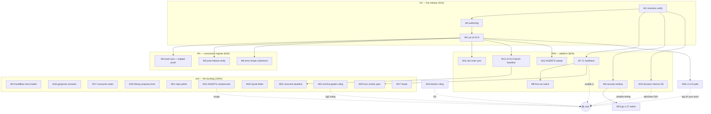

# SUPERB Pareto Plan — v0.15.0 Release Train (Error Surface) + Full Backlog

**Date:** 2026-10-17 03:40 CEST
**Planner:** docs-health-verified backlog + pareto-planning skill (user's `.md`+mermaid format instruction wins over the skill's HTML default — flagged per the override rule)
**Baseline:** v0.14.0 tagged + released; `[Unreleased]` carries the structured error surface (9 Added + 3 Changed bullets); 46 `*Client` methods / 17 resources; ALL local gates green as of the 03:36 docs-health pass (build, vet, lint 0, markdownlint 0, doc-verify, spec-drift exit 0 vs live 2027Q1, `nix flake check` all passed)
**Source of truth:** `TODO_LIST.md` (rebuilt + verified 2026-10-17 03:15), `CHANGELOG.md [Unreleased]`, the 03:36 status report, the 01-55/01-43/00-07 reports, decision memos D1–D5

---

## 0) What v0.15.0 IS (read this first)

v0.15.0 is **the structured error surface release** — the error-system-excellence
epic that shipped to master on 2026-10-16 and is staged in `[Unreleased]`:

- **Added:** `APIError.Details` (structured wire envelope, `WiseErrorDetail`),
  `WiseErrorCode` open enum + 11 `errors.Is` code-sentinels + `HasCode`,
  **`BadRequestError`** (400s are now a first-class typed error — BREAKING for
  consumers who matched bare `*APIError` on 400s), `docs/error-codes.md`,
  the central named error catalog (51 domain codes + 4 exported sentinels),
  `checks.anchor-check`, `checks.linter-allowlist`, `checks.script-fixtures`,
  README DI & Health Checks section, `.markdownlint.json`, the v0.14.0
  benchstat baseline file.
- **Changed:** coverage floor single-sourced at 92.0 (ci.yml is THE floor),
  `Describe("Health")` typed-error contract tests, `spec_drift.py`
  extraction-floor guard + `PYTHONDONTWRITEBYTECODE`.
- **No new endpoints, no signature changes to existing methods** — the
  breaking surface is exclusively the error hierarchy (additive types + one
  reclassification).

**Release-train reference pattern:** M1–M3 of the executed 21:45 v0.14.0 plan
(inventory verify → authoring → cut), which shipped clean. This plan re-uses
that shape with the error-system specifics.

## 1) Pareto Breakdown

| Tier | Share | Delivers | Tasks |
| ---- | ----- | -------- | ----- |
| **1%** | ~3 tasks | **51%** — the release actually ships: inventory verified, `[0.15.0]` authored, tag + Release + proxy live | M1–M3 |
| **4%** | +3 tasks | **64%** — consumers can actually migrate: bank-sync compile-proof, breaking-change migration surfaces coherent, post-release verification | M4–M6 |
| **20%** | +7 tasks | **80%** — the platform around the release: CI resurrection readiness, security window, decision memos, doc-truth sync, bench baseline | M7–M13 |
| **rest** | +14 tasks | **100%** — the full backlog: micro-batch, AGENTS compression, go/parser extractor, consumer notes, raw-idea graduations, v1.0 path, rituals | M14–M27 |

**The 1% is the release itself.** Everything else in this plan is either
subordinated to it (do it before the tag), enabled by it (post-release doc
sync), or independent of it (the rest tier — safe to interleave).

## 2) Comprehensive Plan — 27 medium tasks (30–100 min each, ALL TODOs)

| # | Tier | Task | Effort | Deps | Gate |
| --- | --- | --- | --- | --- | --- |
| M1 | 1% | **Release-inventory verify:** diff `git log v0.14.0..HEAD` against `[Unreleased]` (gap list both directions); re-run the count-claim battery (doc-verify + anchor-check + `go doc` method count); build/vet/lint/flake-check on the final tree; art-dupl group count sanity (23 baseline) | 60m | — | — |
| M2 | 1% | **v0.15.0 release authoring:** cut `CHANGELOG [0.15.0]` from `[Unreleased]` WITH the breaking-migration table (`*BadRequestError` promotion, sentinel matching recipes, `Details` surface); write `docs/releases/v0.15.0-release-notes.md`; bump `wise.Version`; README status line → v0.15.0; re-run release-notes-check + doc-verify | 60m | M1 | — |
| M3 | 1% | **Cut v0.15.0:** clean-tree commit of the authoring; `nix run .#pre-release` (full chain: dirty-refusal, build, vet, race, lint, flake check, doc-verify, release-notes-check, pin-sync, spec-drift, apidiff); annotated tag; `git push origin master --tags` (push explicitly authorized in the planning template); `gh release create v0.15.0 --latest`; proxy `.info` + clean-dir `go get` verification | 90m | M2 | push authorized; `gh release` is routine (v0.12–v0.14 precedent) |
| M4 | 4% | **Consumer migration hardening:** scratch-compile bank-sync against the tagged tree (replace/GOWORK); verify the `*BadRequestError` migration snippet and the sentinel-matching recipe compile; re-verify the README decision-tree snippets against the TAG (not master) | 60m | M3 | — |
| M5 | 4% | **Post-release verification:** `gh release view v0.15.0` render check (code spans/tables); proxy `@v/list`; pkg.go.dev lag note (up to ~1h, non-signal 404 on /fetch); note the frozen coverage badge (CI disabled) | 45m | M3 | — |
| M6 | 4% | **Error-recipe coherence sweep:** `docs/error-codes.md` ↔ README decision tree ↔ CHANGELOG migration table ↔ `Example_errorMatchingSentinels` all tell ONE story; fix any drift found on sight | 45m | M3 | — |
| M7 | 20% | **CI resurrection readiness:** verify final `ci.yml` (pinned tools, nix job + release-notes check, 92.0 coverage gate read from ci.yml, erraudit job, art-dupl warn-first, pin-sync job); YAML negative-check; leave ONLY `gh workflow enable ci` to the user | 60m | M1 | enable 🟡 |
| M8 | 20% | **CI first-run watch package:** triage runbook (CI-only failure classes: env, permissions, toolchain), badge-job verification steps, art-dupl 22→blocking decision note | 45m | M7 | first run 🟡 |
| M9 | 20% | **Security-window watch:** probe `nix eval nixpkgs#go.version`; when 1.26.9 lands: `nix flake update nixpkgs` → vendor FOD re-verify → full buildflow run → re-measure govulncheck/vulnix (the 9 stdlib vulns GO-2026-6603..6617) | 30m + window | M1 | window timing 🟡 |
| M10 | 20% | **Decision-memo batch:** write D6 (BUILDFLOW_NO_RESULT_CACHE standing default — options from 01-55 §g3); refresh `2026-10-16_open-user-asks.md` with v0.15.0 context; verify D1–D5 pointers still valid | 45m | M1 | decisions 🟡 |
| M11 | 20% | **Post-release doc-truth sync:** README/ROADMAP/FEATURES/AGENTS "staged in [Unreleased]" → "shipped in v0.15.0"; release-strategy line; DOMAIN_LANGUAGE gains the error-system terms (`WiseErrorCode`, code-sentinel, `Details` envelope); count-claims re-derived | 60m | M3 | — |
| M12 | 20% | **AGENTS post-release sweep:** verify the error-catalog/sentinel conventions gotchas still match the shipped code; add any release-train gotchas that surfaced; prune what v0.15.0 made stale | 30m | M3 | — |
| M13 | 20% | **Cut the v0.15.0 benchstat baseline** (six separate `-count 1` captures per the Ginkgo ban) + `docs/bench/README.md` table row (the documented "next baseline at v0.15.0" convention) | 45m | M3 | — |
| M14 | rest | **Buildflow/infra micro-batch:** full-diff `.golangci.yml` vs pre-`ce52551` (confirm only `lll` + exclusions rule lost); verify + file the md-go-validator nested-fence extraction defect; comment the bandit/pytest line-fallback reproductions on BuildFlow #64; delete migrated `~/.cache/buildflow/buildflow.db` once a fresh run proves it unread; `interrogate` disposition | 60m | — | upstream filings |
| M15 | rest | **AGENTS.md compression pass (part 1):** bullet-by-bullet under carry-every-concept; target <45 KB this pass (rubric fails >50 KB; <30 KB is the plan target — needs a second pass, do NOT bulk-compress) | 90m | M12 | 🟡 scope ruling (03:36 §g3) |
| M16 | rest | **spec_drift extractor rewrite on stdlib `go/parser`** — kills the call-shape-bug class; re-run `checks.script-fixtures` + a live spec-drift after | 90m | — | — |
| M17 | rest | **README consumer-guidance notes:** retry composition (consumer retries multiplying SDK retries) + transport redaction for injected `WithHTTPClient` middleware (twelve-factor residue, now routed) | 45m | — | — |
| M18 | rest | **`Quote` residual wire fields:** parse `rateExpirationTime` / `targetAmountAllowed` / `user` + mapper tests (only when a consumer needs them — demand-gated, keep behind M4–M6 feedback) | 30m | — | demand |
| M19 | rest | **Money property/fuzz tests** over the `toMoney` boundary (cents conversion, currency validation edges) | 60m | — | — |
| M20 | rest | **CI fuzz smoke job spec** — 30s run of the four fuzz targets; land the yaml ready-to-enable | 30m | M7 | enable 🟡 |
| M21 | rest | **Repo polish:** `.github/ISSUE_TEMPLATE/config.yml` (blank-issues toggle + discussions link) | 30m | — | — |
| M22 | rest | **Archive-grade pass** over api-docs-study + implementation-plan tier tables (per-row strikes) → archive both, OR re-affirm banner-grade (the 03:36 report's open question) | 60m | — | 🟡 §g1 ruling |
| M23 | rest | **Go 1.27 condition watch:** re-probe the 4 unlock conditions; execute `2026-10-07_go-1.27-migration-plan.md` only when all hold (nixpkgs stable 1.27, in-house deps verified, erraudit local install, buildflow skip removal) | 30m | M9 | conditions 🟡 |
| M24 | rest | **Darwin matrix execution:** apply D5 (drop x86_64-darwin) or the pin alternative, per the user's ruling in the decision memos | 30m | — | 🟡 D5 ruling |
| M25 | rest | **Consume the v0.15.0 baseline** in the first perf-touching PR (benchstat comparison in the PR description) | 30m | M13 | cadence |
| M26 | rest | **v1.0.0 path:** apidiff + audit growth-lineage refresh at v0.15.0; confirm no blocking deltas; tag on the user's word | 45m | M3 | tag 🟡 |
| M27 | rest | **Rituals:** annotate the 03:36 status report + THIS plan inline as their items ship; HARVEST any new residue into TODO_LIST at sweep time | 30m | M3 | — |

**Estimated total:** ≈ 29–31h across all tiers; the 1%+4% spine (M1–M6) is
≈ 6h and is the entire difference between "v0.15.0 exists" and "consumers
migrated".

## 3) Fine Breakdown — 96 tasks (≤12 min each, ALL TODOs)

| # | M | Task | Min | Gate |
| --- | --- | --- | --- | --- |
| T1 | M1 | `git log v0.14.0..HEAD --oneline` → map every commit to a `[Unreleased]` bullet; list gaps both directions | 12 | — |
| T2 | M1 | `nix run .#doc-verify` + `nix run .#anchor-check` on the final tree | 12 | — |
| T3 | M1 | `go build ./... && go vet ./...` | 6 | — |
| T4 | M1 | `golangci-lint run` (expect 0) | 12 | — |
| T5 | M1 | `nix flake check` (expect all passed) | 12 | — |
| T6 | M1 | `art-dupl -t 2 --type-aware .` count check (23 accepted baseline) | 12 | — |
| T7 | M2 | Draft `CHANGELOG [0.15.0]` Added section from `[Unreleased]` | 12 | — |
| T8 | M2 | Draft `[0.15.0]` Changed section | 12 | — |
| T9 | M2 | Write the breaking-migration table (`*BadRequestError` promotion; `errors.AsType` still reaches `*APIError` via embedding; sentinel recipes) | 12 | — |
| T10 | M2 | Write `docs/releases/v0.15.0-release-notes.md` (count-claims gate-checked) | 12 | — |
| T11 | M2 | `wise.Version = "0.15.0"` + go doc smoke | 6 | — |
| T12 | M2 | README status callout → v0.15.0 | 6 | — |
| T13 | M2 | `nix run .#release-notes-check` + `nix run .#doc-verify` re-run | 12 | — |
| T14 | M3 | Final commit of the authoring (detailed message) | 6 | — |
| T15 | M3 | `nix run .#pre-release` full chain, exit captured unpiped | 12 | — |
| T16 | M3 | Fix anything the chain flags (loop until green; no verdict-faking) | 12 | — |
| T17 | M3 | Annotated tag `v0.15.0` on the release commit | 6 | — |
| T18 | M3 | `git push origin master --tags` (authorized by the planning template) | 6 | authorized |
| T19 | M3 | `gh release create v0.15.0 --latest` with the release notes body | 12 | — |
| T20 | M3 | Proxy verification: `@v/list` + `.info` + clean-dir `go get github.com/larsartmann/wise-go@v0.15.0` | 12 | — |
| T21 | M4 | Scratch module: bank-sync's `GetTransfer` + error handling against `replace … => .` at the TAG | 12 | — |
| T22 | M4 | Scratch-compile the `*BadRequestError` migration snippet (v0.14.0 vs v0.15.0 both documented) | 12 | — |
| T23 | M4 | Scratch-compile the sentinel-matching recipe (`errors.Is` through a wrap chain) at the tag | 12 | — |
| T24 | M4 | Re-verify README decision-tree snippets against the TAG tree (identifier pass) | 12 | — |
| T25 | M5 | `gh release view v0.15.0` — code spans + tables render check | 6 | — |
| T26 | M5 | pkg.go.dev lag check (≤1h; `/fetch` 404 is non-signal) | 6 | — |
| T27 | M5 | Note the frozen coverage badge state in the release session log | 6 | — |
| T28 | M6 | Cross-read `docs/error-codes.md` vs README "How to match an error" — table-by-table | 12 | — |
| T29 | M6 | Cross-read the CHANGELOG migration table vs `Example_errorMatchingSentinels`/`ExampleAPIError_HasCode` | 12 | — |
| T30 | M6 | Fix any drift found (docs-only edits + gates) | 12 | — |
| T31 | M7 | Read final `ci.yml` end-to-end; list every job + its gate | 12 | — |
| T32 | M7 | Verify tool pins (gofumpt/govulncheck env versions; erraudit pseudo-version) | 12 | — |
| T33 | M7 | Verify the coverage gate reads THE 92.0 floor from ci.yml (M12 parity shape) | 6 | — |
| T34 | M7 | YAML negative-check of the workflow (parse + job graph) | 12 | — |
| T35 | M7 | Write the one-line enable instruction for the user (exact command + expected first-run shape) | 6 | — |
| T36 | M8 | Draft the CI-only-failure triage runbook (env / permissions / toolchain / cache) | 12 | — |
| T37 | M8 | Badge-job verification checklist (coverage.json rewrite, rebases-before-push) | 12 | — |
| T38 | M8 | Art-dupl warn→blocking decision note (22-group baseline context) | 12 | 🟡 |
| T39 | M9 | `nix eval nixpkgs#go.version` probe; record in TODO security-window row | 6 | — |
| T40 | M9 | Pre-stage the update procedure (`nix flake update nixpkgs` → FOD hashes → buildflow full run) as a checklist | 12 | — |
| T41 | M9 | Post-update: re-measure govulncheck/vulnix; update the warning-class census | 12 | window |
| T42 | M10 | Write D6 memo: BUILDFLOW_NO_RESULT_CACHE standing default (options + recommendation) | 12 | — |
| T43 | M10 | Refresh `2026-10-16_open-user-asks.md` with v0.15.0-era context | 12 | — |
| T44 | M10 | Verify D1–D5 pointers in TODO_LIST still resolve to valid memos | 6 | — |
| T45 | M11 | README/ROADMAP/AGENTS/FEATURES: "staged in [Unreleased]" → "shipped in v0.15.0" | 12 | — |
| T46 | M11 | ROADMAP release-strategy line + release-state block for v0.15.0 | 12 | — |
| T47 | M11 | DOMAIN_LANGUAGE: add `WiseErrorCode`, code-sentinel, `Details` envelope terms | 12 | — |
| T48 | M11 | FEATURES error-handling section: verify rows match the shipped surface | 12 | — |
| T49 | M11 | Re-run doc-verify + anchor-check after the doc sync | 12 | — |
| T50 | M11 | CHANGELOG `[Unreleased]` is empty again — verify (it should be) | 6 | — |
| T51 | M12 | AGENTS: re-verify the error-catalog + matching-contract gotchas against shipped code | 12 | — |
| T52 | M12 | AGENTS: add/prune release-train gotchas; net-negative bytes target | 12 | — |
| T53 | M13 | Six `go test -bench . -benchmem -count 1 -run '^$'` captures (GOEXPERIMENT set) | 12 | — |
| T54 | M13 | `benchstat` the six runs → `docs/bench/2026-10-17_v0150_baseline.txt` | 12 | — |
| T55 | M13 | `docs/bench/README.md` table row (v0.14.0 → v0.15.0 comparison) | 6 | — |
| T56 | M14 | `git diff <pre-ce52551>..HEAD -- .golangci.yml` — confirm ONLY lll + exclusions rule | 12 | — |
| T57 | M14 | md-go-validator nested-fence defect: reproduce at source, verify, file upstream | 12 | filing |
| T58 | M14 | Comment the bandit/pytest line-fallback reproductions on BuildFlow #64 | 12 | filing |
| T59 | M14 | Fresh buildflow run → confirm legacy `buildflow.db` unread → delete it | 12 | — |
| T60 | M14 | `interrogate` disposition: identify which tool buildflow means; install or exclude | 12 | — |
| T61 | M15 | AGENTS compression: gotchas 1–8 (carry-every-concept rewrite, net-bytes tracked) | 12 | 🟡 scope |
| T62 | M15 | AGENTS compression: gotchas 9–16 | 12 | 🟡 scope |
| T63 | M15 | AGENTS compression: gotchas 17–24 | 12 | 🟡 scope |
| T64 | M15 | AGENTS compression: Conventions section | 12 | 🟡 scope |
| T65 | M15 | AGENTS compression: Dependencies section | 12 | 🟡 scope |
| T66 | M15 | AGENTS compression: Build & Dev section; re-run gates (anchors! counts!) | 12 | — |
| T67 | M16 | Read `scripts/spec_drift.py` extractor; sketch the `go/parser` visitor shape | 12 | — |
| T68 | M16 | Implement the visitor (method/path extraction incl. `c.request` indirection) | 12 | — |
| T69 | M16 | Parity test: old regex vs new parser on this repo (same 43 endpoints) | 12 | — |
| T70 | M16 | Swap in, re-run `checks.script-fixtures` + live spec-drift | 12 | — |
| T71 | M17 | README retry-composition note (consumer retries × SDK retries) | 12 | — |
| T72 | M17 | README transport-redaction note (auth + financial data in injected middleware) | 12 | — |
| T73 | M18 | Parse `Quote` residual fields (raw + public + mapper) | 12 | — |
| T74 | M18 | Mapper tests + corruption edges | 12 | — |
| T75 | M18 | FEATURES/CHANGELOG rows | 6 | — |
| T76 | M19 | Fuzz `Money` construction + `toMoney` (currency validation edges) | 12 | — |
| T77 | M19 | Property test: cents round-trip invariants | 12 | — |
| T78 | M19 | Wire into the suite; coverage-floor check still passes | 6 | — |
| T79 | M20 | Draft the fuzz-smoke CI job yaml (30s, four targets) | 12 | — |
| T80 | M20 | Negative-check the yaml; park behind the enable gate | 6 | 🟡 |
| T81 | M21 | `.github/ISSUE_TEMPLATE/config.yml` (blank-issues toggle + discussions link) | 12 | — |
| T82 | M21 | Verify templates still render (bug_report.yml / feature_request.yml intact) | 6 | — |
| T83 | M22 | api-docs-study §2 tier tables: per-row verdicts OR banner-grade reaffirmation | 12 | 🟡 ruling |
| T84 | M22 | Implementation-plan tier-2/3 rows: same decision, same pass | 12 | 🟡 ruling |
| T85 | M22 | If archive-grade: check-rows gate → `git mv` → manifest entries | 12 | — |
| T86 | M23 | Re-probe the 4 go-1.27 unlock conditions; record state | 12 | conditions |
| T87 | M23 | If met: execute the migration plan single-commit; full battery | 12 | conditions |
| T88 | M24 | Apply the darwin ruling (drop x86_64-darwin or pin 26.05 input) | 12 | 🟡 D5 |
| T89 | M24 | `nix flake check --all-systems` verify after the change | 12 | — |
| T90 | M25 | First perf-touching PR: benchstat old-vs-new in the description | 12 | cadence |
| T91 | M25 | No-regression verdict recorded (or accepted-regression rationale) | 12 | — |
| T92 | M26 | apidiff v0.15.0 vs HEAD; growth-lineage refresh in the v1.0 audit | 12 | — |
| T93 | M26 | Confirm no blocking deltas; brief the user for the tag word | 12 | 🟡 |
| T94 | M26 | Tag v1.0.0 on approval (pre-release → tag → release → proxy verify) | 12 | 🟡 |
| T95 | M27 | Annotate the 03-36 status report §f as its items ship | 12 | — |
| T96 | M27 | HARVEST sweep: new residue → TODO_LIST/ROADMAP; archive THIS plan when done | 12 | — |

**Fine-task total: 96 · ≈ 19h (the overlap with the medium estimates is the
per-task gate/setup overhead).**

## 4) Execution Graph

## 5) Execution errata (corrections made during planning)

1. **The TODO_LIST this plan is built on is the 03:15 corrected one** — the
   stale "Cut v0.14.0" row (release already shipped) was discovered and
   deleted in the 03:36 docs-health pass, so no task here re-dispatches it.
2. **D6 gap found:** `BUILDFLOW_NO_RESULT_CACHE` has TODO options (01-55 §g3)
   but no decision memo — M10/T42 writes it.
3. **Baseline convention honored:** "next baseline at v0.15.0" (22:44 §f32)
   → M13, not a new idea.
4. **Push authorization:** the planning template explicitly orders
   `git commit & git push` — T18 pushes master + tags. Everything else
   user-gated stays gated (CI enable, tokens, v1.0.0 tag, the six decisions).
5. **Verschlimmbesserer guards:** no bulk AGENTS compression without the
   ruling; no extractor rewrite without the parity test (T69); the release
   cut re-runs the FULL pre-release chain rather than trusting earlier greens
   (T15–T16).

## 6) Post-plan state

After M1–M6: **v0.15.0 exists, is verified, and bank-sync can migrate.**
After M7–M13: the platform is one user-word away from CI and the docs tell
the truth. The rest tier is interleavable at any point without blocking the
train.
