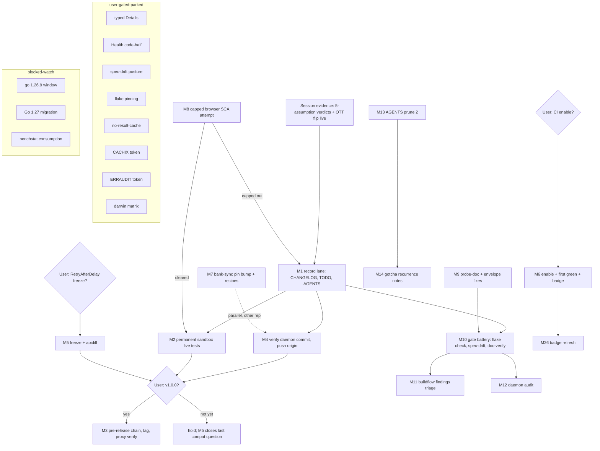

# SUPERB Plan — Post-v0.15.0: Close the Sandbox Lane, Gate v1.0

**Date:** 2026-10-17 08:28 CEST · **Author:** Crush session (post-sandbox-key drop)
**Inputs:** `TODO_LIST.md` (post-v0.15.0-train sync + this session's OTT-item removal), `ROADMAP.md`, status reports `2026-10-17_05-33`, `05-45`, `08-00`, the 03-40 SUPERB v0.15.0 train plan (archived), `docs/planning/2026-10-16_decision-memos.md` (D1–D5).
**Repo state:** HEAD `38d9942`, tree clean, gates green (`go test`, `golangci-lint`). 4 unpushed commits (OTT Q4 flip pair, sweep restoration `594a23a`, daemon-swept 08:00 status report).
**Context:** v0.15.0 shipped the structured error surface; the 08:00 session dropped the long-blocked sandbox key and executed most of the P1 sandbox lane (OTT Q4 flip DONE + live-verified; assumptions 4+5 verified; 1+2 partial; 3 SCA-gated; modernizer sweep #4 repaired). The repo's remaining leverage is: durable-recording that lane, converting its evidence into permanent tests, and clearing the user-gated decisions standing between the tree and `v1.0.0`.

---

## Errata (openness corrections, Step 0)

| TODO item as written | Reality after the 08:00 session | Action |
| --- | --- | --- |
| P1: "Run the sandbox live-verification pass (5 assumptions)" | 60% executed: #4 rates + #5 funding-errors verified; #1 COMPACT/FLAT accepted-but-content-SCA-gated; #2 header-accepted but creation locked; #3 blocked by same SCA gate | Re-frame → "record verdicts + finish-or-bank residuals" |
| P2: "Add credentialed sandbox integration tests (first recorded run missing)" | First recorded run DONE (PASS, 08:00 session) | Re-frame → "CHANGELOG entry + permanent key-gated tests" |
| P1 (removed): OTT 2026Q3→2026Q4 flip | DONE + live-verified (CHANGELOG `[Unreleased]`) | Already struck |
| Everything else in TODO_LIST/ROADMAP | Verified still open (grep'd CHANGELOG + code) | Ranked below |

---

## Pareto Breakdown

### The 1% that delivers 51%

1. **`v1.0.0` tag decision** — one irreversible yes; the audit is green through 46 methods, the error epic closed in v0.15.0, every gate is green. Nothing else on the list changes the project's trajectory as much per minute spent.
2. **Push the 4 unpushed commits** — user already ordered it in the commissioning prompt; makes the OTT flip + sweep repair + lane report durable on origin.
3. **Sandbox-lane recording bundle** — CHANGELOG entry + TODO strikes + AGENTS sandbox gotchas: converts a morning of throwaway /tmp evidence into permanent project memory (the 5-assumption verdicts, the SIGNATURE-challenge shape, the balance-creation lock, the funding-404 wire fact).

### The 4% that delivers 64% (adds)

4. **Permanent key-gated sandbox live tests** — rates shape, `GetOTTStatus` Q4, funding-404, SCA-challenge shape (+ retry-with-OTT when cleared): the suite compounds every future session; completes the P2 item honestly.
5. **`RequestLog.RetryAfterDelay` freeze decision** — the ONLY open API-compat question pre-v1.0 (apidiff says so); answering it removes the last design caveat from the tag.
6. **CI enable + first green run** — runbook, badge checklist, art-dupl promotion criteria all pre-written; unfreezes the coverage badge and restores push-gates.
7. **bank-sync pin bump to v0.15.0 + error-recipe pointing** — the primary consumer gets the structured-error surface (compile-verified already); the only remaining work is mechanical.

### The 20% that delivers 80% (adds)

8. **One bounded (~30 min) browser SCA attempt** — close assumptions 1+3 fully or bank the partial verdict; hard cap prevents the rabbit hole that ate 1.5h this morning.
9. **Probe-doc + envelope fixes** — CONTRIBUTING rollover ritual still says "non-404" (wrong: body-shape is the discriminator); `docs/error-codes.md` gains the observed top-level-`code`-only envelope variant (`non.existing.balance`).
10. **Gate battery** — `nix flake check` (post nixpkgs bump), `nix run .#spec-drift` (post-Q4-flip sanity), 08:29 buildflow findings review, daemon-commit audit `93601d1..HEAD`.
11. **AGENTS.md prune part 2** — 47.4 KB → <30 KB, carry-every-concept rule.

### The other 20% (to 100%)

12. Parked decisions with memos written (Health code-half D2, spec-drift posture D3, flake pinning D4, darwin matrix D5, `BUILDFLOW_NO_RESULT_CACHE`), user-token items (CACHIX, ERRAUDIT), security-window watch (blocked on nixpkgs go 1.26.9), Go 1.27 migration (blocked on 4 conditions), benchstat consumption (armed, awaiting a perf-touching PR), typed recipient `Details` (freeze-map + typed accessors later), crush-config push/activation (other repo, question outstanding), coverage badge refresh post-CI, `lll` recurrence note in the AGENTS buildflow gotcha.

---

## Comprehensive Plan — medium granularity (30–100 min each)

Sorted by importance/impact/effort/customer-value. **Imp** = impact 1–5, **CV** = customer value 1–5, **Eff** = effort in minutes.

| ID | Task | Tier | Imp | CV | Eff | Status/Blocked |
|----|------|------|-----|----|----|----------------|
| M1 | Record sandbox lane: CHANGELOG entry (first live run + 5 verdicts + 2 wire findings), TODO strikes, AGENTS sandbox gotchas | 1% | 5 | 4 | 40 | unblocked |
| M2 | Permanent key-gated live tests in `sandbox_live_test.go` (rates, OTT-status Q4, funding-404, SCA shape) | 4% | 5 | 5 | 90 | unblocked |
| M3 | `v1.0.0` tag: pre-release chain, tag, release notes, proxy/pkg.go.dev verification | 1% | 5 | 5 | 60 | **user yes** |
| M4 | Push 4 unpushed commits (+ plan commit) | 1% | 4 | 3 | 10→30 | unblocked (ordered) |
| M5 | `RetryAfterDelay` freeze decision + (if freeze) doc lock + apidiff re-run | 4% | 4 | 4 | 45 | **user decision** |
| M6 | CI enable + first green run + badge unfreeze (runbook: `2026-10-17_ci-first-run-watch-package.md`) | 4% | 4 | 4 | 90 | **user yes** |
| M7 | bank-sync: pin bump v0.15.0, point errors at `docs/error-codes.md` recipes, sentinel-idiom sweep | 4% | 4 | 5 | 80 | unblocked (other repo) |
| M8 | Bounded browser SCA attempt → assumptions 1+3 full close OR partial-verdict banking | 20% | 3 | 2 | 30 | capped |
| M9 | CONTRIBUTING probe-body-shape fix + `error-codes.md` envelope variant | 20% | 3 | 2 | 35 | unblocked |
| M10 | Gate battery: `nix flake check`, `#spec-drift`, `#doc-verify`, `#release-notes-check` | 20% | 3 | 3 | 50 | unblocked |
| M11 | 08:29 buildflow findings review (warning-class triage per pre-dispositioned policy) | 20% | 2 | 1 | 40 | unblocked |
| M12 | Daemon-commit audit `93601d1..HEAD` + attribution table (incl. 38d9942 verification) | 20% | 2 | 1 | 45 | unblocked |
| M13 | AGENTS.md prune part 2 (47.4→<30 KB, carry-every-concept) | 20% | 2 | 1 | 100 | unblocked |
| M14 | `lll` recurrence + sweep #4 notes into AGENTS buildflow/modernizer gotchas | 20% | 2 | 1 | 30 | unblocked |
| M15 | Crush-config: push local commits + home-manager activation | 20% | 3 | 2 | 30 | **user yes** (other repo) |
| M16 | Typed recipient `Details` decision (freeze map at v1.0 + typed accessors later?) | rest | 3 | 3 | 30 | **user decision** |
| M17 | Health code-half per memo D2 (additive `VerifyCredentials` v1.1?) | rest | 2 | 2 | 60 | **user decision** |
| M18 | Spec-drift gate posture per memo D3 | rest | 2 | 1 | 30 | **user decision** |
| M19 | Flake pinning strategy per memo D4 | rest | 2 | 1 | 30 | **user decision** |
| M20 | `BUILDFLOW_NO_RESULT_CACHE=1` standing default | rest | 1 | 1 | 30 | **user decision** |
| M21 | Set `CACHIX_AUTH_TOKEN` + drop `continue-on-error` on cachix step | rest | 2 | 1 | 30 | **user token** |
| M22 | Set `ERRAUDIT_TOKEN` + make erraudit job blocking | rest | 2 | 1 | 30 | **user token** |
| M23 | Security window: go 1.26.9 watch + checklist execution when open | rest | 3 | 3 | 60 | blocked (nixpkgs) |
| M24 | Go 1.27 migration (execute plan when 4 conditions hold) | rest | 3 | 2 | 100 | blocked (conditions) |
| M25 | benchstat baseline consumption on first perf-touching PR | rest | 1 | 1 | 30 | armed/waiting |
| M26 | Coverage badge refresh verification post-CI-enable | rest | 1 | 1 | 30 | after M6 |
| M27 | darwin matrix decision per memo D5 (drop x86_64-darwin) | rest | 1 | 1 | 30 | **user decision** |

**Sequencing:** M1→M4→M10 first (make durable, publish, verify); M2 next; user-gated M3/M5/M6 whenever the word lands; M7 parallel (other repo); M8 capped single attempt; then the rest by table order.

---

## Detailed Breakdown — fine granularity (≤12 min each)

Every medium task decomposed; each micro-task is independently verifiable. Grouped by parent, sorted by importance within group.

| ID | Parent | Micro-task (≤12 min) | Verification |
|----|--------|----------------------|--------------|
| F1.1 | M1 | CHANGELOG `[Unreleased]`: first recorded sandbox-live run entry | rendered diff |
| F1.2 | M1 | CHANGELOG: 5-assumption verdict entry (4✓ 5✓ 1△ 2△ 3△) | rendered diff |
| F1.3 | M1 | CHANGELOG: 2 wire findings (funding-404 content-type; top-level-code envelope) | rendered diff |
| F1.4 | M1 | TODO_LIST: strike P1 sandbox-pass item with verdict pointer | grep gone |
| F1.5 | M1 | TODO_LIST: re-frame P2 sandbox tests item to "permanent tests" (M2) | diff |
| F1.6 | M1 | AGENTS: sandbox-lane gotcha (SIGNATURE shape, balance lock, served window Q2..Q1, body-shape probe) | diff |
| F1.7 | M1 | `nix fmt` + `go test ./...` after doc edits | exit 0 |
| F2.1 | M2 | Test: `TestSandboxLiveGetExchangeRate` current + historical, Time non-zero | PASS w/ key, SKIP w/o |
| F2.2 | M2 | Test: `TestSandboxLiveGetOTTStatus` (raise via statement 403 → status Q4 fields) | PASS w/ key |
| F2.3 | M2 | Test: `TestSandboxLiveFundTransferNotFound` (404 body surfaced, type asserted) | PASS w/ key |
| F2.4 | M2 | Test: `TestSandboxLiveSCAChallengeShape` (403 empty body, OTT issued, typed) | PASS w/ key |
| F2.5 | M2 | Test: CreateBalance sandbox-lock verdict pinned (403 `non.existing.balance`) | PASS w/ key |
| F2.6 | M2 | Keyless skip-path re-verified (`go test` w/o env) | SKIP, suite green |
| F2.7 | M2 | Conformance-gate interaction check (new exchanges recorded?) | suite green |
| F2.8 | M2 | Coverage floor still met after additions | flake check |
| F3.1 | M3 | Pre-release chain `nix run .#pre-release -- --shuffle` | exit 0 |
| F3.2 | M3 | Release notes cut + `#release-notes-check` | exit 0 |
| F3.3 | M3 | Tag `v1.0.0` (annotated) + push tag | tag on origin |
| F3.4 | M3 | Proxy verification (`@v/list`, `go get` clean dir) | fetches |
| F3.5 | M3 | pkg.go.dev page watch (≤1h lag is normal) | page live |
| F4.1 | M4 | Verify 38d9942 content = the 08:00 status report only | `git show --stat` |
| F4.2 | M4 | Commit plan file (+ any lane docs) | clean tree |
| F4.3 | M4 | `git push origin master` | origin == HEAD |
| F5.1 | M5 | Present decision memo (freeze shape vs observer interface) | user answer |
| F5.2 | M5 | If freeze: godoc + README lock note | diff |
| F5.3 | M5 | Re-run `#apidiff` to confirm zero open deltas | clean output |
| F6.1 | M6 | `gh workflow enable ci` | state enabled |
| F6.2 | M6 | Trigger run + watch first job | green |
| F6.3 | M6 | Triage per runbook (badge, art-dupl criteria) | runbook checked |
| F6.4 | M6 | Badge % refresh verification | README badge |
| F7.1 | M7 | bank-sync: `go get wise-go@v0.15.0` + build | compiles |
| F7.2 | M7 | Point error handling at `docs/error-codes.md` recipes | diff |
| F7.3 | M7 | Sentinel-idiom sweep (`errors.Is` additions) | tests green |
| F7.4 | M7 | bank-sync gates + commit | green |
| F8.1 | M8 | Browser probe rerun with 20s hard timeout + trace screenshots | DOM dump |
| F8.2 | M8 | Fix login flow from probe evidence | logged-in URL |
| F8.3 | M8 | Statements view + `go run . retry` with fresh OTT | statements CSV |
| F8.4 | M8 | `txns` census → assumption 3 verdict | details.type list |
| F8.5 | M8 | If capped-out: partial-verdict bank in TODO/CHANGELOG | diff |
| F9.1 | M9 | CONTRIBUTING step-1 rewrite (body-shape discriminator) | diff |
| F9.2 | M9 | `error-codes.md`: envelope variant section | diff |
| F9.3 | M9 | md checks (`#doc-verify`, `#release-notes-check`) | exit 0 |
| F10.1 | M10 | `nix flake check` (post nixpkgs bump) | exit 0 |
| F10.2 | M10 | `nix run .#spec-drift` post-flip sanity | exit 0 |
| F10.3 | M10 | `nix run .#doc-verify` | exit 0 |
| F10.4 | M10 | `golangci-lint run` + `go test -race ./...` | exit 0 |
| F11.1 | M11 | Read 08:29 buildflow findings summary | notes |
| F11.2 | M11 | Triage warning-class per pre-dispositioned policy (no re-triage) | dispositions |
| F12.1 | M12 | Enumerate `93601d1..HEAD` daemon commits + authors | table |
| F12.2 | M12 | Verify each heuristic commit's content vs intent | table complete |
| F12.3 | M12 | Record attribution anomalies in status doc | diff |
| F13.1 | M13 | AGENTS section census (byte sizes per bullet) | table |
| F13.2 | M13 | Compress batch 1 (top-5 largest bullets) | size −N |
| F13.3 | M13 | Compress batch 2 + carry-concept audit | size −N |
| F13.4 | M13 | Final size check <30 KB + gates | wc -c |
| F14.1 | M14 | AGENTS buildflow gotcha: `lll` recurrence note (d8e28b5) | diff |
| F14.2 | M14 | AGENTS modernizer gotcha: sweep #4 note (92bab25→594a23a) | diff |
| F15.1 | M15 | crush-config: review local commits vs origin | log diff |
| F15.2 | M15 | Push + home-manager activation | deployed |
| F15.3 | M15 | Fan-out guard run (`check-skill-fanout.sh`) | exit 0 |
| F16–F27 | M16–M27 | Each decision/blocked item: single 12-min action — present memo, await word, execute the one-liner, or re-probe the blocking condition (nixpkgs version, tag existence) | per item |

(F16–F27 are deliberately single-action: their medium parents are decision-gated; each fine step is "surface the memo → apply the decided one-liner → verify".)

---

## Execution Graph (mermaid)

---

## Verschlimmbesserung guards

- No gate is skipped to make a task green; no config reverted without byte-identical restoration evidence.
- M8 hard-capped at 30 min (the morning's 1.5h browser hang is the cautionary tale).
- User-gated items stay gated: tagging, enabling CI, pushing OTHER repos, and token secrets are one explicit word each — surfaced, never assumed.
- Every doc edit round-trips `nix fmt` + the relevant check before commit (changelog-only commits structurally fail pre-commit — fold docs into code-touching commits or add a dprint-covered file).
