# SUPERB Pareto Plan — Verdict Trust, Gated Unlock, and the Full Backlog (2026-10-23 11:50 CEST)

**Method:** docs-health-verified TODO_LIST (rewritten this morning, every item re-verified against CHANGELOG/code during sweep #2) + the three 2026-10-23 status reports + ROADMAP raw ideas. Nothing re-dispatched: every item below was confirmed still open today (park-landed pre-check applied). The living source remains `TODO_LIST.md`; this file is the point-in-time execution plan.

**State of the world this plan starts from:** v0.16.0 shipped; surface 46 methods / 136 types / 31 const groups; all 2026-0x historical docs archived with inline verdicts; AGENTS split-brains fixed; working tree clean (`9c31708`); gates green (anchor-check 101/101, doc-verify, flake check). The bottleneck is NOT code — it is **verdict trust** (every green gate rides a stale BuildFlow binary and CI is off) and a **queue of 11+ user decisions** that blocks roughly a third of the backlog.

---

## 1. The Pareto breakdown

### The 1% that delivers 51% — **Verdict trust + the gated unlock** (T1–T3)

Three actions convert the project from "probably fine, locally verified, advisory-grade" to "verified by construction":

| #  | Action                                                                                                                                                                                                                                                                | Why it is the 1%                                                                                                                                                                                                                                          |
| -- | --------------------------------------------------------------------------------------------------------------------------------------------------------------------------------------------------------------------------------------------------------------------- | --------------------------------------------------------------------------------------------------------------------------------------------------------------------------------------------------------------------------------------------------------- |
| T1 | **One decision sitting: answer all 11 standing decision memos** (Health, spec-drift posture, flake pinning, darwin drop, result-cache default, vulnix replacement, go-directive policy, erraudit posture, archive-grade definition, TODO P-composition, AGENTS split) | 11 of ~52 backlog rows are BLOCKED on exactly this. One hour of owner time unlocks a third of the plan at zero code risk. Highest leverage-per-minute in the entire backlog.                                                                              |
| T2 | **Rebuild the BuildFlow binary + fresh full run**                                                                                                                                                                                                                     | Every green verdict since the binary went stale (`e547e2b` vs `952cf3e`) is advisory-grade. This single manual step restores trust in the project's own gate.                                                                                             |
| T3 | **Enable CI + first-run watch + badge unfreeze**                                                                                                                                                                                                                      | Converts local-only verification into fleet verification, activates 8 maintained jobs (incl. the fuzz smoke + network pin-sync), un-freezes the coverage badge, and retires the "releases ship on local gates" risk that every release currently carries. |

### The 4% that delivers 64% — **+ freeze the API, re-verify everything, kill the silent-pointer class** (T4–T6)

| #  | Action                                                       | Why it is the next 13%                                                                                                                                                                   |
| -- | ------------------------------------------------------------ | ---------------------------------------------------------------------------------------------------------------------------------------------------------------------------------------- |
| T4 | **v1.0.0 tag + release train**                               | The audit is green, the surface is stable at 46 methods, the freeze is the project's stated strategic goal (ROADMAP Axis 2). One gated command + the pre-release chain.                  |
| T5 | **Post-sweep full buildflow + gitleaks + codespell battery** | Closes the verification debt this morning's flake.nix touch created; re-establishes the warning-class floor on a fresh binary (T2).                                                      |
| T6 | **Quoted-title gate in `anchor_check.py`**                   | The 07:22 sweep proved paraphrased cross-references break silently; this gate turns the whole defect class (5 known sites, regrowing) into a gate failure. Permanent, compounding value. |

### The 20% that delivers 80% — **+ memory durability, security posture, spec truth, the two lanes** (T7–T14)

T7 daemon format-gap closure · T8 daemon observability · T9 sandbox assumptions 1+3 (browser attempt or permanent verdicts) · T10 bank-sync pin push + recipe sweep · T11 AGENTS prune part 2 (54→<30 KB) · T12 AGENTS taxonomy/index/compression · T13 security posture execution (vulnix replacement + go-directive) · T14 spec-refresh (2027Q1 canonicalization + vendored snapshot + D3 posture). These eight make the documentation system durable, settle the security story, and re-ground the API contract against Wise's live surface.

### The remaining 80% of work-items (the last 20% of result) — T15–T25 + the parked set

Typed `Details` spike, Health code-half, secrets, count-inflation reconcile, upstream filings, docs-integrity disambiguation, docs micro-consistency, the December FEATURES re-sweep, seasonal conventions — plus the parked demand-gated set (wave-2 sentinels, Balance residual fields, webhook quickstart, release automation, fleet pin-drift, wishlist, upstream watches). All listed, none lost, most waiting on T1's verdicts or a demand signal.

---

## 2. Execution graph

```mermaid
flowchart TD
    T1{"T1 ⏳ Decision batch<br/>(11 rulings, ~60 min user)"}
    T2{"T2 ⏳ BuildFlow rebuild<br/>+ fresh full run"}
    T3{"T3 ⏳ CI enable<br/>+ first-run watch"}
    T4{"T4 ⏳ v1.0.0 tag<br/>+ release train"}

    T5["T5 Post-sweep battery<br/>buildflow + gitleaks + codespell"]
    T6["T6 Quoted-title gate<br/>(anchor_check.py)"]

    T7["T7 Daemon format gap<br/>(WASM sandbox or post-commit)"]
    T8["T8 Daemon observability"]
    T9["T9 ⏳ Sandbox 1+3<br/>browser attempt or bank"]
    T10["T10 ⏳ Bank-sync push<br/>+ recipe sweep"]
    T11["T11 AGENTS prune pt2<br/>(54→30 KB)"]
    T12["T12 AGENTS taxonomy<br/>+ index + compression"]
    T13["T13 Security posture<br/>(vulnix + go-directive)"]
    T14["T14 Spec refresh<br/>(2027Q1 + snapshot)"]

    T15["T15 Typed Details spike"]
    T16["T16 Health code-half"]
    T17["T17 Secrets + gate un-skip"]
    T18["T18 Count-inflation reconcile"]
    T19["T19 Upstream filings"]
    T20["T20 docs-integrity disambiguation"]
    T21["T21 Docs micro-consistency"]
    T22["T22 FEATURES re-sweep (Dec)"]
    T23["T23 Seasonal conventions"]
    T24["T24 Parked demand-gated set"]
    T25["T25 ⏳ RetryAfterDelay freeze (v1.x)"]

    T1 --> T7
    T1 --> T13
    T1 --> T15
    T1 --> T16
    T1 --> T12
    T2 --> T5
    T3 --> T17
    T8 --> T7
    T4 --> T25
    T6 --> T12
    T14 --> T5
```

Reading: T1 and T2 are the roots — start both first (T1 is owner time, T2 is owner hands). T3 and T4 follow the owner's word. Everything in the 20% tier is executable the moment its T1 verdict lands; T5/T6/T11 run unblocked today.

---

## 3. Comprehensive plan — 30–100 min tasks (ALL todos, sorted by tier → impact/effort/value)

| ID  | Task                                                                                                                                                                                                                                                                                                                                                                                                                                                                          | Tier | Impact   | Effort  | Value     | Depends         | Owner        |
| --- | ----------------------------------------------------------------------------------------------------------------------------------------------------------------------------------------------------------------------------------------------------------------------------------------------------------------------------------------------------------------------------------------------------------------------------------------------------------------------------- | ---- | -------- | ------- | --------- | --------------- | ------------ |
| T1  | Decision batch #1 — rule on all 11 standing memos                                                                                                                                                                                                                                                                                                                                                                                                                             | 1%   | Critical | 60 min  | Very high | —               | ⏳ user      |
| T2  | BuildFlow binary rebuild + profile swap + fresh full run                                                                                                                                                                                                                                                                                                                                                                                                                      | 1%   | Critical | 90 min  | Very high | —               | ⏳ user + me |
| T3  | CI enable + first-run watch + badge unfreeze + posture execution                                                                                                                                                                                                                                                                                                                                                                                                              | 1%   | Critical | 90 min  | Very high | —               | ⏳ user + me |
| T4  | v1.0.0 tag decision + full release train                                                                                                                                                                                                                                                                                                                                                                                                                                      | 4%   | Critical | 90 min  | Very high | —               | ⏳ user + me |
| T5  | ~~Post-sweep verification battery (buildflow --fix + gitleaks + codespell)~~ done 2026-10-23 (tree at 9d2f6e0) — govulncheck floor EXACT (48 findings / 10 advisories, as dispositioned), gitleaks + codespell both clean, `go 1.26.0` pin verified; 2 infra-only step failures: nix-fmt roundtrip sandbox omits go.mod (reproducible standalone, direct `nix fmt` exit 0 / 0 changed — stale-binary suspect, re-verify at T2), lychee full-run flake (passes standalone 1/1) | 4%   | High     | 45 min  | High      | sweep landed    | me           |
| T6  | ~~Quoted-title gate in `anchor_check.py` (+ fixtures + flake wiring)~~ done at fe9feef+f49d40b — exact/unique-prefix title registry + self-test pass/drift classes + wired into checks.anchor-check (self-test) and the pre-release chain; 5 defect sites fixed (2 quoted paraphrases incl. the TODO truncation, 2 informal pointers, 1 noun-shaped external quote reworded); 101 anchors + 6 quoted pointers verified                                                        | 4%   | High     | 100 min | High      | —               | me           |
| T7  | Daemon format-gap closure (vendored-WASM sandbox check or post-commit check)                                                                                                                                                                                                                                                                                                                                                                                                  | 20%  | High     | 90 min  | High      | T1, T8          | me           |
| T8  | Daemon observability (locate, document, heartbeat)                                                                                                                                                                                                                                                                                                                                                                                                                            | 20%  | Medium   | 45 min  | Medium    | —               | ⏳ user + me |
| T9  | Sandbox assumptions 1+3 — capped browser attempt or permanent verdicts                                                                                                                                                                                                                                                                                                                                                                                                        | 20%  | Medium   | 60 min  | Medium    | —               | ⏳ user + me |
| T10 | Bank-sync v0.16.0 pin push + error-codes recipe follow-through                                                                                                                                                                                                                                                                                                                                                                                                                | 20%  | Medium   | 60 min  | Medium    | —               | ⏳ user + me |
| T11 | AGENTS prune part 2 — ~54 KB → <30 KB, carry-every-concept — PARTIAL 2026-10-23: 54,411 → 52,687; six biggest bullets compressed to evidence pointers, GOEXPERIMENT + CI-state dup facts folded, auto-configure chain trimmed; every removal verified greppable in `.buildflow.yml`/`.gitleaks.toml`/`.codespellrc`/`.go-structure-linter.yaml`/narratives (TODO row updated); ~23 KB delta needs a full-rewrite pass, not clause trims                                       | 20%  | Medium   | 100 min | High      | —               | me           |
| T12 | AGENTS taxonomy + mini-index + placement audit + supersedes compression — PARTIAL 2026-10-23: mini-index landed + 3 misfiled bullets moved to owning sections (title-diff vs f49d40b shows moves + one title compression only); subsection taxonomy pending the T1.12 user call                                                                                                                                                                                               | 20%  | Medium   | 90 min  | Medium    | T6 (gate first) | me           |
| T13 | Security posture execution — vulnix replacement wiring OR accepted-gap doc; go-directive execution                                                                                                                                                                                                                                                                                                                                                                            | 20%  | High     | 60 min  | High      | T1              | me           |
| T14 | Spec refresh — live re-download, 2027Q1 canonicalization, snapshot update, D3 posture                                                                                                                                                                                                                                                                                                                                                                                         | 20%  | Medium   | 90 min  | Medium    | T1 (D3)         | me           |
| T15 | Typed recipient `Details` design spike (census + options + memo)                                                                                                                                                                                                                                                                                                                                                                                                              | 80%  | Medium   | 60 min  | Medium    | T1              | me           |
| T16 | `Health` code-half implementation per D2 verdict                                                                                                                                                                                                                                                                                                                                                                                                                              | 80%  | Medium   | 60 min  | Medium    | T1              | me           |
| T17 | Secrets (CACHIX, ERRAUDIT) + remove `continue-on-error` gates                                                                                                                                                                                                                                                                                                                                                                                                                 | 80%  | Medium   | 30 min  | Medium    | T3              | ⏳ user + me |
| T18 | Buildflow count-inflation reconcile (bandit 78-vs-1; "9 tools" PATH audit)                                                                                                                                                                                                                                                                                                                                                                                                    | 80%  | Low      | 45 min  | Low       | T2              | me           |
| T19 | Upstream filings — nixpkgs/vulnix NVD-404 issue; crush-config scoped-dprint step                                                                                                                                                                                                                                                                                                                                                                                              | 80%  | Low      | 60 min  | Low       | —               | me           |
| T20 | ~~docs-integrity warning disambiguation + gone-confirmation~~ done 2026-10-23 — the post-sweep full run shows NO docs-integrity warning anywhere (preflight doctor 39 ok / 0 warn / 0 fail); nothing left to disambiguate                                                                                                                                                                                                                                                     | 80%  | Low      | 30 min  | Low       | T5              | me           |
| T21 | ~~Docs micro-consistency batch (dedupe, OTEL check, tight lists, narratives verify)~~ done 2026-10-23 — README↔AGENTS OTEL claims consistent (Observability → OpenTelemetry pointer correct); all 5 narratives citations verified to resolve; two-vs-three runtime deps annotated in the narratives doc; Build & Dev vs CONTRIBUTING dedupe ACCEPTED as cross-audience double-entry; tight lists stay dispositioned (markdownlint unwired, dprint owns markdown)              | 80%  | Low      | 60 min  | Low       | —               | me           |
| T22 | FEATURES external-claims re-sweep (215-op census due ~2026-12-16)                                                                                                                                                                                                                                                                                                                                                                                                             | 80%  | Medium   | 90 min  | Medium    | —               | me (Dec)     |
| T23 | ~~Seasonal conventions (VERIFY cadence doc, ./result guard, gitleaks allowlist shape)~~ done 2026-10-23 — one AGENTS bullet: ~8-week external-claims re-sweep cadence (next ~2026-12-16), `./result` deliberately ungated (operator-rebuild rule), gitleaks allowlist stays commit-pinned with rationale                                                                                                                                                                      | 80%  | Low      | 45 min  | Low       | T1 (partial)    | me           |
| T24 | Parked demand-gated backlog (listed in §5, no scheduled time)                                                                                                                                                                                                                                                                                                                                                                                                                 | 80%  | —        | —       | —         | demand          | —            |
| T25 | `RequestLog.RetryAfterDelay` API freeze — v1.x planning item                                                                                                                                                                                                                                                                                                                                                                                                                  | 80%  | Low      | 30 min  | Low       | T4              | ⏳           |

---

## 4. Detailed breakdown — ≤12 min tasks (ALL todos, sorted by tier → order)

### T1 — Decision batch #1 (⏳ user, ~60 min total)

| #    | Subtask                                                                             | Min |
| ---- | ----------------------------------------------------------------------------------- | --- |
| 1.1  | Read `docs/planning/2026-10-16_decision-memos.md` (D2–D6) end to end                | 12  |
| 1.2  | Rule: `Health` code-half (D2: additive `VerifyCredentials` in v1.1?)                | 5   |
| 1.3  | Rule: spec-drift `--fail-on-drift` posture (D3)                                     | 5   |
| 1.4  | Rule: flake pinning rev-vs-tag (D4)                                                 | 5   |
| 1.5  | Rule: x86_64-darwin drop (D5)                                                       | 5   |
| 1.6  | Rule: `BUILDFLOW_NO_RESULT_CACHE=1` standing default (D6)                           | 5   |
| 1.7  | Rule: vulnix replacement (grype/syft vs accepted gap)                               | 10  |
| 1.8  | Rule: go-directive policy (patch-pin 1.26.9 vs wait for 1.27)                       | 10  |
| 1.9  | Rule: erraudit CI posture (blocking vs warn-not-fail)                               | 5   |
| 1.10 | Rule: archive-grade definition (work-items-struck vs every-table, sweep-2 §g1)      | 5   |
| 1.11 | Rule: TODO P-composition (P2-as-user-gated vs P1 release-train bucket, sweep-2 §g2) | 5   |
| 1.12 | Rule: AGENTS.md structural split (single file vs per-area `context_paths`)          | 10  |
| 1.13 | Record all verdicts: annotate decision memos + rewrite TODO rows                    | 12  |

### T2 — BuildFlow rebuild (⏳ user + me, ~90 min)

| #   | Subtask                                                                      | Min |
| --- | ---------------------------------------------------------------------------- | --- |
| 2.1 | ⏳ `nix profile remove` stale buildflow (manual, #35 workaround)             | 10  |
| 2.2 | ⏳ `nix profile add` fresh build from repo pin                               | 10  |
| 2.3 | `buildflow doctor` — verify binary freshness ≥ repo HEAD                     | 5   |
| 2.4 | `BUILDFLOW_NO_RESULT_CACHE=1 buildflow --fix --build-mode=full` (background) | 60  |
| 2.5 | Read verdict; compare findings vs stale-binary floor (48 govulncheck)        | 12  |
| 2.6 | Record verdict in AGENTS (binary-freshness gotcha) + report delta            | 12  |

### T3 — CI enable (⏳ user + me, ~90 min)

| #   | Subtask                                                                                  | Min |
| --- | ---------------------------------------------------------------------------------------- | --- |
| 3.1 | ⏳ `gh workflow enable ci`                                                               | 5   |
| 3.2 | Watch first run against the triage runbook (`2026-10-17_ci-first-run-watch-package.md`)  | 12  |
| 3.3 | Triage/fix first-run fallout (nix fetch, jobs, secrets) — repeat 12-min blocks as needed | 12× |
| 3.4 | Verify art-dupl / fuzz-smoke / pin-sync / coverage jobs green                            | 12  |
| 3.5 | Unfreeze coverage badge; confirm README badge updates on master push                     | 12  |
| 3.6 | Execute erraudit posture per 1.9 (delete `continue-on-error` or keep warn)               | 12  |
| 3.7 | Update AGENTS "CI workflow is disabled" gotcha + TODO row to shipped                     | 12  |

### T4 — v1.0.0 release train (⏳ user + me, ~90 min)

| #   | Subtask                                                                    | Min |
| --- | -------------------------------------------------------------------------- | --- |
| 4.1 | ⏳ v1.0.0 approval (irreversible — explicit word required)                 | 5   |
| 4.2 | `nix run .#pre-release` (refuses dirty tree; full chain)                   | 60  |
| 4.3 | Annotated tag `v1.0.0` + push                                              | 10  |
| 4.4 | GitHub Release + `docs/releases/v1.0.0-release-notes.md` (46-method claim) | 12  |
| 4.5 | Verify: proxy `@v/list` + clean-dir `go get module@v1.0.0`                 | 12  |
| 4.6 | Move `RequestLog.RetryAfterDelay` freeze to v1.1 planning (T25)            | 12  |
| 4.7 | Update ROADMAP Axis-2 v1.0 block + TODO row + CHANGELOG                    | 12  |

### T5 — Post-sweep battery (me, ~45 min)

| #   | Subtask                                                                      | Min |
| --- | ---------------------------------------------------------------------------- | --- |
| 5.1 | Confirm daemon swept the 13-path batch (`git log`)                           | 2   |
| 5.2 | `BUILDFLOW_NO_RESULT_CACHE=1 buildflow --fix --build-mode=full` (background) | 60  |
| 5.3 | On-demand `buildflow -s gitleaks -s codespell`                               | 12  |
| 5.4 | Triage warnings vs the dispositioned floor; zero new error-severity          | 12  |
| 5.5 | `grep '^go ' go.mod` pin check before any commit                             | 2   |

### T6 — Quoted-title gate (me, ~100 min)

| #    | Subtask                                                                   | Min |
| ---- | ------------------------------------------------------------------------- | --- |
| 6.1  | Read `scripts/anchor_check.py` structure (doc sweep, matchers, self-test) | 12  |
| 6.2  | Design: bold-title registry per living doc; quoted-string matcher         | 12  |
| 6.3  | Implement title extraction (parse `**Title**` bullets per doc)            | 12  |
| 6.4  | Implement `"quoted"` verification against the registry                    | 12  |
| 6.5  | Extend `--self-test` with the rename-drift class                          | 12  |
| 6.6  | Fix the known paraphrase pointers in AGENTS (2 informal sites)            | 12  |
| 6.7  | Wire the check into `checks.anchor-check` + pre-release chain             | 12  |
| 6.8  | Full sweep over living docs; fix every finding it raises                  | 12  |
| 6.9  | Document the gate in the AGENTS anchor gotcha                             | 12  |
| 6.10 | Include CONTRIBUTING quoted titles in scope                               | 5   |

### T7 — Daemon format gap (me, ~90 min; shape per 1.x + T8)

| #   | Subtask                                                              | Min |
| --- | -------------------------------------------------------------------- | --- |
| 7.1 | Path A: extract dprint plugin list + versions from `dprint.json`     | 12  |
| 7.2 | Path A: `fetchurl` derivations ×4 + prepared `DPRINT_CACHE_DIR`      | 12  |
| 7.3 | Path A: sandboxed `dprint check` derivation (hermetic)               | 12  |
| 7.4 | Path A: wire `checks.format-dprint` into `nix flake check`           | 12  |
| 7.5 | Path A: negative-test (staged unformatted file fails the check)      | 12  |
| 7.6 | Path B (if T1 rules so): daemon-side post-commit `dprint check` hook | 30  |

### T8 — Daemon observability (⏳ user + me, ~45 min)

| #   | Subtask                                                                      | Min |
| --- | ---------------------------------------------------------------------------- | --- |
| 8.1 | ⏳ Owner identifies the daemon (process/unit/script/cron)                    | 10  |
| 8.2 | Document location + cadence + hook-bypass intent in the AGENTS daemon gotcha | 12  |
| 8.3 | Heartbeat file or documented log path; "is it alive" answerable              | 12  |

### T9 — Sandbox assumptions 1+3 (⏳ user + me, ~60 min)

| #   | Subtask                                                     | Min |
| --- | ----------------------------------------------------------- | --- |
| 9.1 | ⏳ Sandbox web login (2FA catch-all `111111`)               | 12  |
| 9.2 | DOM probe (20 s timeout) → COMPACT-vs-FLAT content diff     | 12  |
| 9.3 | `details.type` enum census capture                          | 12  |
| 9.4 | Update TODO/CHANGELOG/AGENTS verdicts + wire shapes         | 12  |
| 9.5 | OR bank PARTIAL/BLOCKED permanently + delete `/tmp` tooling | 12  |

### T10 — Bank-sync push (⏳ user + me, ~60 min)

| #    | Subtask                                                                                     | Min |
| ---- | ------------------------------------------------------------------------------------------- | --- |
| 10.1 | ⏳ Push approval for the sibling repo                                                       | 5   |
| 10.2 | Push the committed v0.16.0 pin bump (go.mod + flake + vendor)                               | 5   |
| 10.3 | Verify their CI/build on the new pin                                                        | 12  |
| 10.4 | Sweep bank-sync error handling vs `docs/error-codes.md` recipe (sentinels vs `AsType`-only) | 36  |
| 10.5 | Update the AGENTS snippet gotcha (bank-sync bullet) with the sweep verdict                  | 12  |

### T11 — AGENTS prune part 2 (me, ~100 min)

| #    | Subtask                                                             | Min |
| ---- | ------------------------------------------------------------------- | --- |
| 11.1 | Size baseline + per-bullet byte inventory; pick the 10 biggest      | 12  |
| 11.2 | Compress batch 1 (narratives → evidence pointers)                   | 12  |
| 11.3 | Compress batch 2 (resolved-incident stories)                        | 12  |
| 11.4 | Compress batch 3 (dup clauses across bullets)                       | 12  |
| 11.5 | Compress batch 4 (Build & Dev entries vs CONTRIBUTING overlap)      | 12  |
| 11.6 | Compress batch 5 (remaining mid-size bullets)                       | 12  |
| 11.7 | Carry-every-concept audit: every removed clause greppable somewhere | 12  |
| 11.8 | Gates: scoped dprint + anchor-check + doc-verify + flake check      | 12  |
| 11.9 | Record new size + remaining delta in the TODO prune row             | 5   |

### T12 — AGENTS taxonomy (me, ~90 min; after T6 so the gate guards the regroup)

| #    | Subtask                                                                           | Min |
| ---- | --------------------------------------------------------------------------------- | --- |
| 12.1 | Design the section taxonomy (Wire / Errors / Build / Linters / Process)           | 12  |
| 12.2 | Regroup Gotchas entries — batch 1                                                 | 12  |
| 12.3 | Regroup Gotchas entries — batch 2                                                 | 12  |
| 12.4 | Placement audit (misfiled Conventions/Gotchas entries, e.g. Accept-Minor-Version) | 12  |
| 12.5 | Mini-TOC / index at top                                                           | 12  |
| 12.6 | Supersedes-chain compression (10-11→17 rulings, auto-configure history)           | 12  |
| 12.7 | Gates + diff review (externally-anchored titles intact: ci.yml, ADRs)             | 12  |

### T13 — Security posture (me, ~60 min; per 1.7/1.8)

| #    | Subtask                                                                                                               | Min |
| ---- | --------------------------------------------------------------------------------------------------------------------- | --- |
| 13.1 | Vulnix path: grype/syft over `./result` evaluation + buildflow step wiring — OR accepted-gap note in `.buildflow.yml` | 36  |
| 13.2 | Go-directive path: patch-pin `1.26.9` execution + go-mod-normalize conflict resolution — OR documented wait           | 12  |
| 13.3 | Re-run govulncheck (+ new scanner); record finding counts in the AGENTS warning gotcha                                | 12  |

### T14 — Spec refresh (me, ~90 min; per 1.3)

| #    | Subtask                                                                                         | Min |
| ---- | ----------------------------------------------------------------------------------------------- | --- |
| 14.1 | Download live spec bundle (custom User-Agent)                                                   | 12  |
| 14.2 | Convert + diff vs vendored JSON (paths / operations / schemas)                                  | 12  |
| 14.3 | Triage deltas; canonicalize OTT surface per the Conventions rollover entry                      | 24  |
| 14.4 | Update `docs/reviews/wise-api-openapi.json` + spec-sanity floors                                | 12  |
| 14.5 | Run `nix run .#spec-drift` + the conformance suite against the new snapshot                     | 12  |
| 14.6 | Execute D3 verdict (wire `--fail-on-drift` into pre-release / scheduled job / keep report-only) | 12  |

### T15 — Typed `Details` spike (me, ~60 min; per 1.x)

| #    | Subtask                                                               | Min |
| ---- | --------------------------------------------------------------------- | --- |
| 15.1 | Corridor census: account-requirements shapes for the top 6 corridors  | 24  |
| 15.2 | Options doc: key constants vs per-corridor structs vs typed accessors | 12  |
| 15.3 | Update/replace the decision memo; v1.x or now recommendation          | 12  |

### T16 — `Health` code-half (me, ~60 min; per 1.2)

| #    | Subtask                                                                           | Min |
| ---- | --------------------------------------------------------------------------------- | --- |
| 16.1 | Implement the ruled shape (additive `VerifyCredentials` / fail-fast path / alias) | 36  |
| 16.2 | BDD contract tests (typed errors, retry semantics per ruling)                     | 12  |
| 16.3 | Docs: godoc + README DI section + FEATURES row                                    | 12  |

### T17 — Secrets (⏳ user + me, ~30 min; after T3)

| #    | Subtask                                                                                 | Min |
| ---- | --------------------------------------------------------------------------------------- | --- |
| 17.1 | ⏳ Create Cachix token + `gh secret set CACHIX_AUTH_TOKEN`; confirm cache exists        | 12  |
| 17.2 | ⏳ Create PAT (erraudit read) + `gh secret set ERRAUDIT_TOKEN`                          | 12  |
| 17.3 | Delete the `continue-on-error`/`if` lines (ci.yml erraudit + cachix jobs); verify green | 12  |

### T18 — Count-inflation reconcile (me, ~45 min)

| #    | Subtask                                                                       | Min |
| ---- | ----------------------------------------------------------------------------- | --- |
| 18.1 | Direct bandit run; parse finding list; compare to buildflow's 78              | 12  |
| 18.2 | Characterize the inflation (per-occurrence vs per-finding? scope difference?) | 12  |
| 18.3 | Audit buildflow env/PATH for the "9 tools unavailable" class                  | 12  |
| 18.4 | Document in AGENTS or file upstream (BuildFlow)                               | 12  |

### T19 — Upstream filings (me, ~60 min)

| #    | Subtask                                                                     | Min |
| ---- | --------------------------------------------------------------------------- | --- |
| 19.1 | Reproduce + capture evidence: NIST 404 endpoints, vulnix traceback          | 12  |
| 19.2 | File the nixpkgs/vulnix issue (github-voice; verify-before-filing passed)   | 12  |
| 19.3 | Draft the scoped-dprint step proposal for crush-config's status-report flow | 12  |
| 19.4 | Apply/file upstream in the crush-config repo + reference here               | 12  |

### T20 — docs-integrity disambiguation (me, ~30 min)

| #    | Subtask                                                                           | Min |
| ---- | --------------------------------------------------------------------------------- | --- |
| 20.1 | Inspect buildflow's docs-integrity preflight behavior (what triggers the warning) | 12  |
| 20.2 | Make "deleted intentionally, sweep pending" visible (message or workflow note)    | 12  |
| 20.3 | Confirm the current warning is gone post-sweep                                    | 5   |

### T21 — Docs micro-consistency (me, ~60 min)

| #    | Subtask                                                                     | Min |
| ---- | --------------------------------------------------------------------------- | --- |
| 21.1 | Build & Dev vs CONTRIBUTING command dedupe (one home + cross-ref)           | 12  |
| 21.2 | README OTEL section vs AGENTS OTEL entry consistency check                  | 12  |
| 21.3 | Tight-list lint pass (markdownlint on-demand or dprint rule decision)       | 12  |
| 21.4 | Verify the 6 AGENTS claims citing `incident-narratives.md` against that doc | 12  |
| 21.5 | Annotate the "two runtime deps" vs three claim (incident-narratives)        | 12  |

### T22 — FEATURES external-claims re-sweep (me, ~90 min; scheduled ~2026-12-16)

| #    | Subtask                                                                     | Min |
| ---- | --------------------------------------------------------------------------- | --- |
| 22.1 | Live preview sweep: category pages → operation census                       | 45  |
| 22.2 | Diff vs the FEATURES matrix (new/deprecated/moved ops)                      | 24  |
| 22.3 | Re-date the census claim + route deltas (PLANNED/DEMAND_GATED/OUT_OF_SCOPE) | 12  |

### T23 — Seasonal conventions (me, ~45 min)

| #    | Subtask                                                                          | Min |
| ---- | -------------------------------------------------------------------------------- | --- |
| 23.1 | VERIFY-sweep cadence convention (AGENTS line: every N weeks)                     | 12  |
| 23.2 | `./result` stale-symlink guard — implement or record the deliberate drop         | 12  |
| 23.3 | gitleaks allowlist shape — migrate to rule-scoped or record commit-pin rationale | 12  |

### T24/T25 — Parked (demand-gated / post-v1.0; listed for completeness, no time boxes)

Wave-2 error-code sentinels · `Balance` residual wire fields · webhook end-to-end README quickstart · release-process automation · fleet pin-drift sweep · wishlist residue (Postman, currency helpers, batch APIs, mock server) · upstream watches (md-go-validator #11, BuildFlow #65/#35) · `WithMetrics` second hook (hold until consumer need) · consume the benchstat baseline in the first perf-touching PR (standing convention) · `RetryAfterDelay` freeze (T25, v1.x planning).

---

## 5. Verschlimmbesserung guards (what this plan must NOT do)

1. **No bulk AGENTS compression without carry-every-concept** — every removed clause must be greppable in a surviving doc; T11.7 is the gate, not a suggestion.
2. **No archived-file edits** — the four files archived today are frozen; corrections happen in living docs only.
3. **No scripted table rewrites** — tables under dprint alignment get hand-written block replacements (sweep-2 §d2 lesson).
4. **No scratch staging in the live repo** — probes go in temp clones (the daemon commits within seconds).
5. **No pipe before a gate's exit code** — `cmd > log; echo $?` always.
6. **No re-enabling skipped buildflow steps without re-reading their in-file rationale** (vulnix, auto-configure, interrogate, file-size, pytest, go-auto-upgrade).
7. **No `git reset --hard`, no force-push, no tag without the pre-release chain exit 0.**

## 6. Errata and sources

- Sources: `TODO_LIST.md` (rewritten 2026-10-23 morning), the three 2026-10-23 status reports (`07-22`, `07-48`, `08-25`), sweep-2 report (`11-27`), `docs/planning/2026-10-16_decision-memos.md` (D2–D6), `docs/planning/2026-10-17_ci-first-run-watch-package.md`, ROADMAP raw ideas.
- Errata: none — no item in this plan was found already shipped while planning (all verified open during this morning's sweep). The Quote residual-fields idea was struck SHIPPED v0.16.0 during that sweep and therefore does NOT appear here.
- When items ship, harvest back via docs-health → TODO_LIST updates; annotate THIS plan non-destructively (strikethrough with hashes), never rewrite.
