# SUPERB Pareto Plan — Verdict Trust Round 2, Health Close, and the Full Backlog (2026-10-31 11:49 CEST)

**Method:** pareto-planning skill. Inputs: the living `TODO_LIST.md` (docs-health-swept 2026-10-23, **+5 rows harvested from the 2026-10-31 samber/do recheck session this morning**), the prior SUPERB plan (`2026-10-23_11-50_SUPERB-pareto-plan-verdict-trust-gated-unlock.md`, 5 of its 25 tasks struck done — verified via CHANGELOG + `git log --since=2026-10-23`: only ONE non-auto commit landed, a docs HTML update), ROADMAP parked set, and the 2026-10-31 recheck + self-review reports. Nothing re-dispatched: every carried item confirmed still open.

**State of the world this plan starts from:** v0.16.0 shipped; surface 46 public methods / 15 resource files; gates green locally at HEAD (flake check, anchor-check 70 OK/0 err, doc-verify, md-go-snippets); CI still OFF; BuildFlow binary still STALE (`e547e2b` vs repo `952cf3e`) so full-run verdicts stay advisory-grade; ~13 user decisions sitting; the 2026-10-31 samber/do recheck found **zero new architecture findings** (self-healthy 3.0→3.5; one user-gated decision F-1b). The bottleneck is unchanged from 2026-10-23: **not code — verdict trust and the gated unlock.**

---

## 0. Errata + corrections found while verifying (so the next session is not misled)

| Finding                                                                                                                                                                                                                    | Disposition                                                                              |
| -------------------------------------------------------------------------------------------------------------------------------------------------------------------------------------------------------------------------- | ---------------------------------------------------------------------------------------- |
| Prior plan T5, T6, T20, T21, T23 already struck done in-place — re-confirmed via CHANGELOG `[Unreleased]` (quoted-title gate, toolchain lock, vulnix skip) and `git log --since=2026-10-23` (1 non-auto commit, docs-only) | Carried forward as DONE; not re-planned                                                  |
| 2026-10-31 recheck report shipped two prose-count errors ("16 resource files" → 15; "two releases" → three) — no gate can catch prose counts in non-swept dirs                                                             | Both fixed same session; process rules in §5                                             |
| The 2026-10-31 session surfaced 6 untracked tasks (ctx-abort test, health docs bundle, AGENTS denominators, series index, recheck cadence, F-1 row split)                                                                  | 5 harvested into TODO_LIST this session; F-1 row split folded into M15 (not TODO-worthy) |

---

## 1. The Pareto breakdown

### The 1% that delivers 51% — **Verdict trust + the gated unlock (M1–M3)**

Identical roots to 2026-10-23 because none of them moved — that is the finding:

| #  | Action                                                                                                                                                                                                                                                                                       | Why it is the 1%                                                                                                                                                            |
| -- | -------------------------------------------------------------------------------------------------------------------------------------------------------------------------------------------------------------------------------------------------------------------------------------------- | --------------------------------------------------------------------------------------------------------------------------------------------------------------------------- |
| M1 | **Decision batch — rule on all 13 sitting decisions** (D2 Health, D3 spec-drift, D4 flake pins, D5 darwin, D6 result-cache, vulnix replacement, go-directive, AGENTS split, + NEW recheck cadence, HealthCheck-alias posture, ctx-abort-test priority, bank-sync push word, v1.0 word is M4) | 13 of ~31 backlog rows are BLOCKED on exactly this. ~60 min of owner time unlocks ~40% of the plan at zero code risk. Still the highest leverage-per-minute in the backlog. |
| M2 | **Rebuild the BuildFlow binary + fresh full run**                                                                                                                                                                                                                                            | Every green full-run verdict still rides the stale binary. One manual profile dance (BuildFlow #35 workaround) restores trust in the project's own gate.                    |
| M3 | **Enable CI + first-run watch + badge unfreeze**                                                                                                                                                                                                                                             | Converts local-only verification into fleet verification (8 jobs), un-freezes the coverage badge, retires "releases ship on local gates."                                   |

### The 4% that delivers 64% — **+ freeze the API, close the Health story, compress memory (M4–M6)**

| #  | Action                                         | Why it is the next 13%                                                                                                                                               |
| -- | ---------------------------------------------- | -------------------------------------------------------------------------------------------------------------------------------------------------------------------- |
| M4 | **v1.0.0 tag + release train**                 | Audit green, surface stable at 46 methods, the strategic goal (ROADMAP Axis 2). One word + the pre-release chain.                                                    |
| M5 | **`Health` code-half per D2 verdict**          | The single open architecture finding (two reviews, one memo, one endorsement): additive `VerifyCredentials(ctx)` + BDD + README guidance. Closes self-healthy 3.5→4+ |
| M6 | **AGENTS.md prune part 3 — full-rewrite pass** | ~23 KB remains to the <30 KB target; clause trims are exhausted (part 2 proved it), so one structured rewrite pass with the carry-every-concept rule.                |

### The 20% that delivers 80% — **+ daemon truth, security posture, spec truth, lanes, health operability (M7–M15)**

M7 daemon format-gap closure · M8 daemon observability · M9 sandbox assumptions 1+3 · M10 bank-sync pin push · M11 security posture execution (vulnix + go-directive per M1 verdicts) · M12 spec refresh 2027Q1 (canonicalization + snapshot + D3 posture) · M13 AGENTS taxonomy/split per M1 verdict · M14 health operability bundle (ctx-abort BDD + README timeout + `ExampleHealth` + godoc exact budget) · M15 docs-trust bundle (AGENTS denominators, series README index, TODO F-1 row split, optional samber/do one-liner).

### The remaining 80% of work-items (the last 20% of result) — M16–M27

Typed `Details` spike, secrets + gate un-skip, buildflow count-inflation reconcile, upstream filings, anchor heading-pointer gate, benchstat baseline consumption, FEATURES December re-sweep (~2026-12-16), recheck-cadence wiring, `RetryAfterDelay` freeze (v1.x), Go 1.27 migration (externally conditioned), decision-execution one-liners (flake pins / darwin / result-cache), parked demand-gated set. All listed, none lost; most wait on M1 verdicts, the calendar, or a demand signal.

---

## 2. Execution graph

```mermaid
flowchart TD
    M1{"M1 ⏳ Decision batch<br/>(13 rulings, ~60 min user)"}
    M2{"M2 ⏳ BuildFlow rebuild<br/>+ fresh full run"}
    M3{"M3 ⏳ CI enable<br/>+ first-run watch"}
    M4{"M4 ⏳ v1.0.0 tag<br/>+ release train"}

    M5["M5 Health code-half<br/>(VerifyCredentials per D2)"]
    M6["M6 AGENTS prune pt3<br/>full-rewrite (→30 KB)"]
    M7["M7 Daemon format gap<br/>(WASM cache or post-commit)"]
    M8["M8 Daemon observability"]
    M9["M9 ⏳ Sandbox 1+3<br/>browser attempt or bank"]
    M10["M10 ⏳ Bank-sync pin push"]
    M11["M11 Security posture<br/>(vulnix + go-directive)"]
    M12["M12 Spec refresh 2027Q1"]
    M13["M13 AGENTS taxonomy/split"]
    M14["M14 Health operability<br/>(BDD + README + example)"]
    M15["M15 Docs-trust bundle<br/>(denominators, index, F-1 row)"]

    M16["M16 Typed Details spike"]
    M17["M17 Secrets + un-skip"]
    M18["M18 Count-inflation reconcile"]
    M19["M19 Upstream filings"]
    M20["M20 Anchor heading gate"]
    M21["M21 Benchstat on next perf PR"]
    M22["M22 FEATURES re-sweep (Dec)"]
    M23["M23 Recheck cadence wiring"]
    M24["M24 RetryAfterDelay freeze (v1.x)"]
    M25["M25 Go 1.27 migration"]
    M26["M26 Decision one-liners<br/>(D4/D5/D6 executions)"]
    M27["M27 Parked demand-gated set"]

    M1 --> M5
    M1 --> M11
    M1 --> M12
    M1 --> M13
    M1 --> M16
    M1 --> M23
    M1 --> M26
    M2 --> M18
    M3 --> M17
    M4 --> M24
    M8 --> M7
    M5 --> M14
    M14 --> M22
    M6 --> M13
    M12 --> M22
```

Reading: M1 and M2 are the roots — start both first (M1 is owner time, M2 is owner hands). M3 and M4 follow the owner's word. M6/M8/M9/M10/M15/M19/M20/M21 run UNBLOCKED today. Everything else unlocks the moment its M1 verdict lands.

---

## 3. Comprehensive plan — 30–100 min tasks (ALL todos, sorted by tier → impact/effort/value)

| ID  | Task (owner: ⏳ = user word needed)                                                                                                                                                                           | Tier | Impact   | Effort  | Value     | Depends     |
| --- | ------------------------------------------------------------------------------------------------------------------------------------------------------------------------------------------------------------- | ---- | -------- | ------- | --------- | ----------- |
| M1  | ⏳ Decision batch — rule on all 13 sitting decisions; annotate memos + rewrite TODO rows                                                                                                                      | 1%   | Critical | 60 min  | Very high | —           |
| M2  | ⏳ BuildFlow binary rebuild (profile remove/add, #35 workaround) + fresh full run + AGENTS verdict update                                                                                                     | 1%   | Critical | 90 min  | Very high | —           |
| M3  | ⏳ CI enable + first-run watch (runbook ready) + badge unfreeze + erraudit posture execution                                                                                                                  | 1%   | Critical | 90 min  | Very high | —           |
| M4  | ⏳ v1.0.0 tag + full release train (pre-release chain, tag, release notes, proxy verify)                                                                                                                      | 4%   | Critical | 90 min  | Very high | —           |
| M5  | `Health` code-half per D2 verdict — additive `VerifyCredentials(ctx)` + BDD mirror + README "which probe when"                                                                                                | 4%   | High     | 60 min  | High      | M1          |
| M6  | AGENTS prune part 3 — full-rewrite pass over the mid-size tail, carry-every-concept, → <30 KB                                                                                                                 | 4%   | High     | 100 min | High      | —           |
| M7  | Daemon format-gap closure — vendored-WASM dprint cache (fetchurl ×4) or daemon-side post-commit check                                                                                                         | 20%  | High     | 90 min  | High      | M1, M8      |
| M8  | Daemon observability — locate the daemon, document heartbeat/log, record hook-bypass intent                                                                                                                   | 20%  | Medium   | 45 min  | Medium    | ⏳ user     |
| M9  | ⏳ Sandbox assumptions 1+3 — capped browser SCA attempt (20s DOM probe, catch-all `111111`) or bank permanent verdicts                                                                                        | 20%  | Medium   | 60 min  | Medium    | ⏳ user     |
| M10 | ⏳ Bank-sync v0.16.0 pin push (committed locally 2026-10-17) + sentinel-sweep recipe follow-through                                                                                                           | 20%  | Medium   | 60 min  | Medium    | ⏳ user     |
| M11 | Security posture execution — vulnix replacement wiring or accepted-gap doc; go-directive execution per verdict                                                                                                | 20%  | High     | 60 min  | High      | M1          |
| M12 | Spec refresh — live re-download, 2027Q1 canonicalization (incl. OTT prefix), snapshot update, D3 posture                                                                                                      | 20%  | Medium   | 90 min  | Medium    | M1 (D3)     |
| M13 | AGENTS taxonomy/subsection structure or per-area split per verdict                                                                                                                                            | 20%  | Medium   | 90 min  | Medium    | M1, M6      |
| M14 | Health operability bundle — ctx-abort BDD (deadline mid-backoff), README timeout line, `ExampleHealth`, godoc exact budget                                                                                    | 20%  | Medium   | 60 min  | Medium    | M5 (docs)   |
| M15 | Docs-trust bundle — AGENTS surface-count denominators, `architecture-understanding/` README index, TODO F-1 row split                                                                                         | 20%  | Medium   | 45 min  | Medium    | —           |
| M16 | Typed recipient `Details` design spike — census + options + memo                                                                                                                                              | 80%  | Medium   | 60 min  | Medium    | M1          |
| M17 | Secrets (CACHIX_AUTH_TOKEN, ERRAUDIT_TOKEN) + delete `continue-on-error` gate lines                                                                                                                           | 80%  | Medium   | 30 min  | Medium    | M3, ⏳ user |
| M18 | Buildflow count-inflation reconcile — bandit 78-vs-1 class + "9 tools unavailable" PATH audit                                                                                                                 | 80%  | Low      | 45 min  | Low       | M2          |
| M19 | Upstream filings (verify-before-filing first) — nixpkgs/vulnix NVD-404; crush-config scoped-dprint                                                                                                            | 80%  | Low      | 60 min  | Low       | —           |
| M20 | Anchor gate → `###`-heading pointers — extend title registry or convert heading refs to quoted form                                                                                                           | 80%  | Low      | 90 min  | Low       | —           |
| M21 | Consume `docs/bench/2026-10-17_v0150_baseline.txt` — benchstat vs first perf-touching PR (install per TODO row)                                                                                               | 80%  | Low      | 30 min  | Low       | perf PR     |
| M22 | FEATURES external-claims re-sweep (~2026-12-16 due; 215-op census refresh + spec-sanity floors)                                                                                                               | 80%  | Medium   | 90 min  | Medium    | calendar    |
| M23 | samber/do+health recheck-cadence wiring per M1 ruling (seasonal join / release trigger / on-demand)                                                                                                           | 80%  | Low      | 30 min  | Low       | M1          |
| M24 | `RequestLog.RetryAfterDelay` API freeze — v1.x planning item (shape lock or observer interface)                                                                                                               | 80%  | Low      | 30 min  | Low       | M4          |
| M25 | Go 1.27 toolchain migration — execute the 2026-10-07 plan when its 4 unlock conditions hold                                                                                                                   | 80%  | Medium   | 90 min  | Medium    | external    |
| M26 | Decision-execution one-liners — D4 rev-pins, D5 darwin drop, D6 result-cache default, applied the day their verdicts land                                                                                     | 80%  | Low      | 30 min  | Low       | M1          |
| M27 | Parked demand-gated set — wave-2 sentinels, `Balance` residual fields, webhook quickstart, release automation, fleet pin-drift sweep, circuit breaker, liveness probe, wishlist leftovers (ROADMAP raw ideas) | 80%  | —        | —       | —         | demand      |

**27 tasks — every open TODO_LIST row (26 pre-existing + 5 harvested this morning, folded into M14/M15/M23) + the parked set. Sort: tier → impact → value/effort.**

---

## 4. Detailed breakdown — ≤12 min tasks (ALL todos, sorted by tier → milestone order)

### M1 — Decision batch (⏳ user, 60 min)

| #    | Subtask                                                                             | Min |
| ---- | ----------------------------------------------------------------------------------- | --- |
| 1.1  | Read `docs/planning/2026-10-16_decision-memos.md` D2–D6 end to end                  | 12  |
| 1.2  | Rule D2: `VerifyCredentials(ctx)` additive in v1.1? (+ `HealthCheck` alias posture) | 5   |
| 1.3  | Rule: ctx-abort BDD test priority now vs upstream-rest (status §g3)                 | 5   |
| 1.4  | Rule D3: spec-drift `--fail-on-drift` posture                                       | 5   |
| 1.5  | Rule D4: flake pinning rev-vs-tag                                                   | 5   |
| 1.6  | Rule D5: x86_64-darwin drop                                                         | 5   |
| 1.7  | Rule D6: `BUILDFLOW_NO_RESULT_CACHE=1` standing default                             | 5   |
| 1.8  | Rule: vulnix replacement (grype/syft vs accepted gap)                               | 10  |
| 1.9  | Rule: go-directive policy (patch-pin 1.26.9 vs wait 1.27)                           | 10  |
| 1.10 | Rule: AGENTS.md structural split (single vs per-area)                               | 10  |
| 1.11 | Rule: recheck cadence (seasonal / release-trigger / on-demand)                      | 5   |
| 1.12 | Word: bank-sync push + sandbox browser attempt + v1.0 (M4/M9/M10 green-light)       | 5   |
| 1.13 | Record verdicts: annotate memos, rewrite TODO rows, errata in this plan             | 12  |

### M2 — BuildFlow rebuild (⏳ user + me, 90 min)

| #   | Subtask                                                              | Min |
| --- | -------------------------------------------------------------------- | --- |
| 2.1 | ⏳ `nix profile remove` stale buildflow (manual, #35 workaround)     | 10  |
| 2.2 | ⏳ `nix profile add` fresh build from repo pin                       | 10  |
| 2.3 | `buildflow doctor` — binary freshness ≥ repo HEAD                    | 5   |
| 2.4 | `BUILDFLOW_NO_RESULT_CACHE=1 buildflow --fix --build-mode=full` (bg) | 60  |
| 2.5 | Compare findings vs stale-binary floor (48 govulncheck exact)        | 12  |
| 2.6 | Record verdict in AGENTS binary-freshness note + status line         | 12  |

### M3 — CI enable (⏳ user + me, 90 min)

| #   | Subtask                                                                                 | Min |
| --- | --------------------------------------------------------------------------------------- | --- |
| 3.1 | ⏳ `gh workflow enable ci`                                                              | 5   |
| 3.2 | Watch first run against the triage runbook (`2026-10-17_ci-first-run-watch-package.md`) | 12  |
| 3.3 | Triage first-run fallout (nix fetch, jobs, secrets) — repeat 12-min blocks              | 12× |
| 3.4 | Verify art-dupl / fuzz-smoke / pin-sync / coverage jobs green                           | 12  |
| 3.5 | Unfreeze coverage badge; confirm README badge updates on master push                    | 12  |
| 3.6 | AGENTS "CI workflow is disabled" gotcha → shipped state + TODO row strike               | 12  |

### M4 — v1.0.0 release train (⏳ user + me, 90 min)

| #   | Subtask                                                                   | Min |
| --- | ------------------------------------------------------------------------- | --- |
| 4.1 | ⏳ v1.0.0 approval (irreversible — explicit word)                         | 5   |
| 4.2 | `nix run .#pre-release` (refuses dirty tree; full chain incl. spec-drift) | 60  |
| 4.3 | Annotated tag `v1.0.0` + push                                             | 10  |
| 4.4 | GitHub Release + `docs/releases/v1.0.0-release-notes.md`                  | 12  |
| 4.5 | Verify: proxy `@v/list` + clean-dir `go get module@v1.0.0`                | 12  |
| 4.6 | ROADMAP Axis-2 v1.0 block + TODO row + CHANGELOG                          | 12  |

### M5 — Health code-half (me, 60 min; per D2-b)

| #   | Subtask                                                                                                            | Min |
| --- | ------------------------------------------------------------------------------------------------------------------ | --- |
| 5.1 | Single-attempt executor path: `VerifyCredentials(ctx)` calling `ListProfiles` with `WithRetry(0, …)`-shaped config | 12  |
| 5.2 | Same typed errors as `Health` (429 → RateLimit, 401 → Auth, 5xx → Server) — reuse classification, no new mapping   | 12  |
| 5.3 | BDD `Describe("VerifyCredentials")` mirroring the Health contexts (fast-exhaust config)                            | 12  |
| 5.4 | Godoc cross-linking Health ↔ VerifyCredentials (which probe when)                                                  | 12  |
| 5.5 | README DI recipe + health section guidance update (scratch-compile vs pinned tag AND master)                       | 12  |
| 5.6 | FEATURES/TODO/CHANGELOG rows + doc gates (dprint → anchor → doc-verify)                                            | 12  |

### M6 — AGENTS prune part 3 (me, 100 min)

| #       | Subtask                                                                                                                                                                                                                | Min  |
| ------- | ---------------------------------------------------------------------------------------------------------------------------------------------------------------------------------------------------------------------- | ---- |
| 6.1     | Inventory the mid-size tail (bytes/section; target list to <30 KB)                                                                                                                                                     | 12   |
| 6.2–6.8 | Rewrite one section cluster per block: Gotchas wire/SCA, timestamps, gates/BuildFlow, deps, sandbox, docs-workflow, seasonal — each: compress to evidence pointers, verify every removed clause greppable at its owner | 12×7 |
| 6.9     | Carry-every-concept audit: diff removed text vs owners (`.buildflow.yml`, narratives, configs)                                                                                                                         | 12   |
| 6.10    | Anchor/doc gates + AGENTS byte count recorded in TODO row                                                                                                                                                              | 12   |

### M7 — Daemon format gap (me, 90 min)

| #   | Subtask                                                                       | Min |
| --- | ----------------------------------------------------------------------------- | --- |
| 7.1 | Decide shape per M8 findings (WASM cache vs daemon post-commit)               | 12  |
| 7.2 | WASM path: `fetchurl` ×4 plugin pins + prepared `DPRINT_CACHE_DIR` in flake   | 12  |
| 7.3 | Hermetic `dprint check` check derivation + negative test (unformatted probe)  | 12  |
| 7.4 | Daemon path: post-commit hook script + location doc from M8                   | 12  |
| 7.5 | Wire chosen path; verify daemon commit of an unformatted file now fails/fixed | 12  |
| 7.6 | AGENTS daemon gotcha update + TODO strike                                     | 12  |

### M8 — Daemon observability (⏳ user + me, 45 min)

| #   | Subtask                                                    | Min |
| --- | ---------------------------------------------------------- | --- |
| 8.1 | ⏳ Owner shows daemon location/unit/log                    | 10  |
| 8.2 | Document heartbeat/log path + hook-bypass intent in AGENTS | 12  |
| 8.3 | Probe cadence: `git log` timestamp heuristic documented    | 12  |
| 8.4 | TODO strike + M7 unblock note                              | 5   |

### M9 — Sandbox assumptions 1+3 (⏳ user + me, 60 min)

| #   | Subtask                                                              | Min |
| --- | -------------------------------------------------------------------- | --- |
| 9.1 | ⏳ Word: attempt (30-min cap) or bank verdicts permanently           | 5   |
| 9.2 | Attempt path: DOM probe (20s timeout) → SCA web flow with catch-all  | 30  |
| 9.3 | Record COMPACT-vs-FLAT content diff + `details.type` census verdicts | 12  |
| 9.4 | Bank path: strike TODO, delete `/tmp` browser tooling, AGENTS note   | 12  |

### M10 — Bank-sync push (⏳ user + me, 60 min)

| #    | Subtask                                                                      | Min |
| ---- | ---------------------------------------------------------------------------- | --- |
| 10.1 | ⏳ Word to push the sibling repo (committed locally 2026-10-17)              | 5   |
| 10.2 | Push + verify CI/job state there; record bump verdict                        | 12  |
| 10.3 | Recipe sweep: point bank-sync error handling at `docs/error-codes.md` recipe | 12  |
| 10.4 | Sweep its `errors.AsType`-only handling for sentinel `errors.Is` adoption    | 12  |
| 10.5 | TODO strike + status line                                                    | 12  |

### M11 — Security posture (me, 60 min)

| #    | Subtask                                                                               | Min |
| ---- | ------------------------------------------------------------------------------------- | --- |
| 11.1 | Execute vulnix verdict: grype/syft buildflow step over `./result` or accepted-gap doc | 30  |
| 11.2 | Execute go-directive verdict (patch-pin vs wait) + govulncheck recount                | 12  |
| 11.3 | AGENTS security entries + TODO strikes                                                | 12  |

### M12 — Spec refresh (me, 90 min)

| #    | Subtask                                                                  | Min |
| ---- | ------------------------------------------------------------------------ | --- |
| 12.1 | Live re-download (custom User-Agent) + diff vs vendored 2026Q3           | 12  |
| 12.2 | 2027Q1 canonicalization sweep (OTT `2027Q1` prefix + subscription check) | 30  |
| 12.3 | Vendored snapshot swap + spec-sanity floors (≥150 paths) recheck         | 12  |
| 12.4 | FEATURES triage of any NEW paths into PLANNED/DEMAND_GATED/ON_HOLD       | 12  |
| 12.5 | D3 posture wiring (scheduled job once CI runs; report-only until then)   | 12  |
| 12.6 | `nix run .#spec-drift -- --fail-on-drift` green + TODO/AGENTS rows       | 12  |

### M13 — AGENTS taxonomy/split (me, 90 min)

| #    | Subtask                                                              | Min |
| ---- | -------------------------------------------------------------------- | --- |
| 13.1 | Execute M1 verdict: single-file taxonomy vs per-area `context_paths` | 30  |
| 13.2 | Single path: subsection taxonomy + placement audit + index refresh   | 12  |
| 13.3 | Split path: file boundaries + `crush.json` `context_paths` wiring    | 30  |
| 13.4 | Split-brain regression probe: one fact one place grep sweep          | 12  |

### M14 — Health operability bundle (me, 60 min)

| #    | Subtask                                                                        | Min |
| ---- | ------------------------------------------------------------------------------ | --- |
| 14.1 | BDD: ctx deadline aborts `Health` mid-backoff (fake slow server + timeout)     | 12  |
| 14.2 | BDD: delay-decision log entry NOT emitted for the aborted attempt              | 12  |
| 14.3 | README DI recipe: ctx-timeout bounding snippet (scratch-compile pinned+master) | 12  |
| 14.4 | `ExampleHealth` compile-only in `example_test.go` (nolint pattern)             | 12  |
| 14.5 | `Health` godoc: exact default budget numbers replacing ~                       | 12  |

### M15 — Docs-trust bundle (me, 45 min)

| #    | Subtask                                                                     | Min |
| ---- | --------------------------------------------------------------------------- | --- |
| 15.1 | AGENTS surface-count denominators harmonized (one convention, cross-refs)   | 12  |
| 15.2 | `docs/architecture-understanding/README.md` index (5 reports, supersession) | 12  |
| 15.3 | TODO F-1 row: strike docs-half done, keep code-half open                    | 12  |
| 15.4 | Optional: one-line AGENTS samber/do absence note (if non-duplicative)       | 9   |

### M16 — Typed Details spike (me, 60 min)

| #    | Subtask                                                         | Min |
| ---- | --------------------------------------------------------------- | --- |
| 16.1 | Corridor census from spec + account-requirements fixtures       | 30  |
| 16.2 | Options memo: typed structs vs key constants vs keep-map-freeze | 20  |
| 16.3 | Record decision memo + TODO update                              | 10  |

### M17 — Secrets (⏳ user + me, 30 min)

| #    | Subtask                                                        | Min |
| ---- | -------------------------------------------------------------- | --- |
| 17.1 | ⏳ Set `CACHIX_AUTH_TOKEN`; confirm `larsartmann` cache exists | 10  |
| 17.2 | ⏳ Set `ERRAUDIT_TOKEN` PAT (read: private erraudit repo)      | 10  |
| 17.3 | Delete the `continue-on-error`/`if` gate lines; jobs blocking  | 10  |

### M18 — Count-inflation reconcile (me, 45 min)

| #    | Subtask                                                            | Min |
| ---- | ------------------------------------------------------------------ | --- |
| 18.1 | Reproduce bandit-class inflation (direct tool vs buildflow counts) | 20  |
| 18.2 | "9 tools unavailable" PATH audit — real missing vs scoping         | 12  |
| 18.3 | Document or file upstream (BuildFlow) with evidence                | 12  |

### M19 — Upstream filings (me, 60 min)

| #    | Subtask                                                           | Min |
| ---- | ----------------------------------------------------------------- | --- |
| 19.1 | Verify-before-filing: nixpkgs/vulnix NVD-404 repro + minimal case | 20  |
| 19.2 | File nixpkgs issue (github-voice skill)                           | 20  |
| 19.3 | Verify + file crush-config scoped-dprint step proposal            | 20  |

### M20 — Anchor heading gate (me, 90 min)

| #    | Subtask                                                                 | Min |
| ---- | ----------------------------------------------------------------------- | --- |
| 20.1 | Census live `###`-heading references + backtick-title pointers in docs  | 20  |
| 20.2 | Decide: registry extension vs convert-to-quoted-form (effort per shape) | 12  |
| 20.3 | Implement chosen path in `scripts/anchor_check.py` + self-test fixtures | 30  |
| 20.4 | Sweep findings to zero; AGENTS gotcha boundary update                   | 20  |

### M21 — Benchstat consumption (me, 30 min, on first perf PR)

| #    | Subtask                                                              | Min |
| ---- | -------------------------------------------------------------------- | --- |
| 21.1 | `go install benchstat@latest`; capture fresh baseline (idle machine) | 12  |
| 21.2 | Compare vs `2026-10-17_v0150_baseline.txt`; record delta in PR       | 12  |
| 21.3 | TODO strike + bench README note                                      | 6   |

### M22 — FEATURES December re-sweep (me, 90 min, ~2026-12-16)

| #    | Subtask                                                    | Min |
| ---- | ---------------------------------------------------------- | --- |
| 22.1 | Live preview census refresh (215-op denominator re-derive) | 30  |
| 22.2 | Spec-sanity floors + operation-coverage matrix reconcile   | 30  |
| 22.3 | New-path triage (PLANNED/DEMAND_GATED/ON_HOLD) + gates     | 30  |

### M23 — Recheck cadence wiring (me, 30 min)

| #    | Subtask                                                         | Min |
| ---- | --------------------------------------------------------------- | --- |
| 23.1 | Execute M1.11 ruling (seasonal join / release trigger / demand) | 12  |
| 23.2 | If seasonal: add to the ~8-week sweep entry in AGENTS           | 12  |
| 23.3 | TODO strike + trigger recorded                                  | 6   |

### M24 — RetryAfterDelay freeze (me, 30 min, v1.x)

| #    | Subtask                                                 | Min |
| ---- | ------------------------------------------------------- | --- |
| 24.1 | Shape lock decision (entry-as-is vs observer interface) | 20  |
| 24.2 | Doc the frozen contract in README/CHANGELOG at v1.x     | 10  |

### M25 — Go 1.27 migration (me, 90 min, externally gated)

| #    | Subtask                                                           | Min |
| ---- | ----------------------------------------------------------------- | --- |
| 25.1 | Condition probe (nixpkgs stable 1.27? in-house deps on 1.27?)     | 12  |
| 25.2 | Execute `2026-10-07_go-1.27-migration-plan.md` single-commit flip | 60  |
| 25.3 | Rollback probe + govulncheck advisory recount + AGENTS rows       | 18  |

### M26 — Decision one-liners (me, 30 min, day-of-verdict)

| #    | Subtask                                                   | Min |
| ---- | --------------------------------------------------------- | --- |
| 26.1 | D4 execution (keep rev pins → close row; or tag-pin flip) | 10  |
| 26.2 | D5 execution (drop x86_64-darwin one-liner in flake)      | 10  |
| 26.3 | D6 execution (`BUILDFLOW_NO_RESULT_CACHE=1` standing)     | 10  |

### M27 — Parked demand-gated set (no scheduled time)

Wave-2 sentinels (conscious pin update when a case appears) · `Balance` residual fields · webhook quickstart · release automation · fleet pin-drift sweep (md-go, go-output, dynamic-markdown-site, …) · circuit breaker · liveness probe endpoint · wishlist leftovers (Postman collection, currency-conversion helpers, batch APIs, mock server). Each opens with a consumer demand signal; none loseable — ROADMAP raw ideas holds them.

---

## 5. Process guardrails for every task above (from the 2026-10-31 self-review)

1. **Derive-then-write** — counts/dates pasted from fresh command output, never recalled (two prose-count bugs shipped 2026-10-31; nothing downstream catches the class in non-swept dirs).
2. **View-after-formatter** — after dprint/treefmt touches a file, `view` before editing.
3. **Heaviest gate LAST** — edits → dprint → anchor-check → doc-verify → `nix flake check`.
4. **Done-bar checklist** per milestone — gate green / TODO row struck / AGENTS updated / status line recorded.
5. **Verschlimmbessern guard** — no speculative rewrites; additive rows only in living docs; every change verifiably no worse than found (incl. this file: TODO_LIST gained 5 rows, nothing removed).

---

## 6. Point-in-time note

Snapshot 2026-10-31 11:49 CEST; living source is `TODO_LIST.md`. Annotate (docs-health ANNOTATE), never rewrite, as milestones land. Supersedes the 2026-10-23 plan's OPEN set only (its struck rows stay struck).

---

## 7. Execution log (2026-10-31 afternoon session, blanket "execute everything" directive)

| M   | Disposition                                                                                                                                                                                                                                                                                                                                                                           |
| --- | ------------------------------------------------------------------------------------------------------------------------------------------------------------------------------------------------------------------------------------------------------------------------------------------------------------------------------------------------------------------------------------- |
| M1  | Partially executed: every memo-backed decision applied as the standing default under the blanket directive (D2 ✓ D4 ✓ D5 ✓ D6 ✓, recheck cadence ✓ seasonal-join, go-directive ✓ policy-wins, vulnix ✓ healed/no-replacement, HealthCheck alias ✓ declined, D3 ✓ report-only + weekly CI job). Still owner's word: v1.0.0 tag (M4), bank-sync push, sandbox browser attempt, secrets. |
| M2  | Binary rebuilt at BuildFlow HEAD `74a9212` (was `4acfb12`); fresh full run this session (see status report).                                                                                                                                                                                                                                                                          |
| M3  | CI **ENABLED** (`gh workflow enable ci`); ci.yml gained `workflow_dispatch` + weekly `spec-drift` job (D3-b). First run fires on the next CODE push (remote predates dispatch; no push from session). Badge unfreezes then.                                                                                                                                                           |
| M4  | HELD — v1.0.0 tag is the one-word irreversible call; not tagged.                                                                                                                                                                                                                                                                                                                      |
| M5  | DONE — `VerifyCredentials(ctx)` + BDD + godoc cross-links + README recipe (scratch-compiled vs master).                                                                                                                                                                                                                                                                               |
| M6  | DONE — full rewrite 56,812 → 40,634 bytes, 69/69 titles preserved, gates green; **<30 KB target retired as unreachable-without-loss** (remaining bullets are normative density).                                                                                                                                                                                                      |
| M7  | DONE — `checks.dprint-format`: fetchurl-pinned WASM plugins, hermetic `dprint check` in `nix flake check`, negative probe built in. Daemon gap closed at gate level.                                                                                                                                                                                                                  |
| M8  | 8.3 DONE (~3-min dirty-tree polling cadence measured); 8.1/8.2/8.4 still need the owner's daemon location.                                                                                                                                                                                                                                                                            |
| M9  | HELD — no browser tooling in the execution environment; both paths (attempt / bank verdicts) remain the owner's call.                                                                                                                                                                                                                                                                 |
| M10 | Sweep DONE locally (bank-sync AGENTS/15 carries the recipe; verdict: all five branches type-appropriate); the PUSH stays user-gated.                                                                                                                                                                                                                                                  |
| M11 | DONE — vulnix: NIST healed (premise gone), on-demand scan documented, skip rationale updated; go-directive: policy wins, warning-class until 1.27.                                                                                                                                                                                                                                    |
| M12 | DONE — both quarterly families canonicalized 2026Q4→2027Q1 (credentialed probe), snapshot re-vendored (188/228), `--fail-on-drift` exit 0, gitleaks clean.                                                                                                                                                                                                                            |
| M13 | Single-file taxonomy retained (placement re-verified in the M6 rewrite); per-area split still the owner's call.                                                                                                                                                                                                                                                                       |
| M14 | DONE — deadline-abort BDD (mid-backoff + Retry-After wait, no post-abort log noise), README ctx-bound snippet, both examples, exact budget in godoc.                                                                                                                                                                                                                                  |
| M15 | DONE — denominators (47/46/15 convention), series README index, F-1 row split, samber/do absence note folded into the AGENTS health-probes convention.                                                                                                                                                                                                                                |
| M16 | DONE — spike memo: keep the map, type the decision not the vocabulary (validation helper parked M27).                                                                                                                                                                                                                                                                                 |
| M17 | HELD — secrets are user credentials; gate-line deletion waits for secrets + green CI.                                                                                                                                                                                                                                                                                                 |
| M18 | DONE — see status report (post-rebuild analysis).                                                                                                                                                                                                                                                                                                                                     |
| M19 | DONE — nixpkgs/vulnix: premise healed, nothing filed (verify-before-filing verdict); crush-config scoped-dprint: filed [#3](https://github.com/LarsArtmann/crush-config/issues/3).                                                                                                                                                                                                    |
| M20 | DONE — heading-pointer registry in `scripts/anchor_check.py` (+self-test classes); census: 0 findings.                                                                                                                                                                                                                                                                                |
| M21 | Not due — no perf PR in flight; convention stays armed (capture-hygiene: idle machine).                                                                                                                                                                                                                                                                                               |
| M22 | Not due — calendar gate ~2026-12-16; M12's re-vendor pre-refreshed the operation count (228).                                                                                                                                                                                                                                                                                         |
| M23 | DONE — seasonal join + lifecycle trigger wired (AGENTS seasonal bullet + series index).                                                                                                                                                                                                                                                                                               |
| M24 | Memo DONE — freeze-entry-as-is recommendation recorded for the v1.x rubber stamp.                                                                                                                                                                                                                                                                                                     |
| M25 | Probed — nixpkgs go 1.26.10: condition 1 still unmet; migration stays externally gated.                                                                                                                                                                                                                                                                                               |
| M26 | DONE — D4 kept, D5 applied (systems list), D6 applied (standing invocation shape).                                                                                                                                                                                                                                                                                                    |
| M27 | Verified held — ROADMAP parked set intact; validation helper joined it (M16).                                                                                                                                                                                                                                                                                                         |
